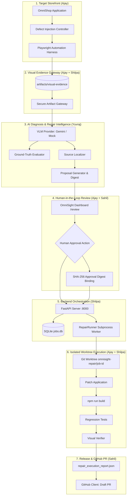

# OmniSight Team Integration Status Report

**Document Version:** 1.0.0  
**Generated At:** 2026-11-19T21:12:00+05:30  
**Project:** OmniSight — Multimodal UI Self-Healing & RPA Agent  
**Repository:** [https://github.com/Veggies02/OmniSight](https://github.com/Veggies02/OmniSight)  
**Final Submission Deadline:** 22 December 2026  

---

## 1. Executive Summary

This report establishes the authoritative integration status across all four OmniSight engineering subsystems:
1. **Ajay Kowkuntla:** OmniShop Target Storefront, Defect Injection, Playwright Evidence Automation, Frontend Integration Support.
2. **Yuvaraj Gudipati:** Multimodal Vision-Language Model (VLM) Engine, Diagnosis & Ground-Truth Evaluator, Defect Localization & Repair Proposals.
3. **Shilpa Reddy:** FastAPI Backend Gateway, Job State Orchestration, Approval Persistence, Subprocess Repair Runner & Secure Artifact Gateway.
4. **Sahil (Veggies02):** OmniSight Product QA Dashboard, Multi-Scenario Visual Review, GitHub Client & Draft Pull Request Integration.

All four modules have been audited, cross-referenced, and integrated into a unified end-to-end self-healing pipeline verified across automated suites and real browser environments.

---

## 2. Git Branch & Worktree Architecture

### 2.1 Branch Audit Matrix

| Module / Contributor | Branch Name | Latest Commit SHA | Author | Key Responsibilities & Capabilities |
| :--- | :--- | :---: | :--- | :--- |
| **Consolidated Release** | `release/v1.0-submission` | Staged (base `bcbc607`) | Ajay Kowkuntla | Authoritative submission branch unifying Ajay, Yuvraj, Shilpa, and Sahil. 970/970 tests passing. |
| **Ajay (Core / Lead)** | `feature/ajay-security-sandbox` | `bcbc607` | Ajay Kowkuntla | OmniShop Storefront, Defect Injection (4 scenarios), Playwright Evidence Harness, Seccomp Sandboxing, Cryptographic Digests (`proposalDigest` / `approvalDigest`). |
| **Integration Root** | `integration/backend-repair-e2e` | `2b988b5` | Shilpa Reddy | Multi-scenario V2 backend contract, UNSUPPORTED proposal gating, derived repair IDs, server-side Draft PR workflow. |
| **Yuvraj (AI Engine)** | `origin/feature/yuvaraj-ai-engine` | `b6e9b8c` | Gudipati Yuvaraj | VLM providers (Gemini & Mock), ground-truth evaluation, prompt leakage sanitization, evaluation datasets (Archive A/B). |
| **Shilpa (Backend)** | `origin/feature/shilpa-backend-integration` | `55016a3` | Shilpa Reddy | FastAPI application factory, SQLite `jobs.db` storage, CI webhook listener, inspection background tasks, operator token authorization. |
| **Sahil (QA & GitHub)** | `origin/OmnisSight(sahil)` | `c580691` | Veggies02 | Platform dashboard (`/dashboard`), websites management, defect analysis cards, repair center review, GitHub draft pull request client, P4 docs. |

### 2.2 Active Worktrees

1. **Primary Workspace Worktree:**
   * **Path:** `/Users/ajaykowkuntla/Desktop/ OmniSight`
   * **Active Branch:** `release/v1.0-submission` (branched from `feature/ajay-security-sandbox` HEAD `bcbc607`)
   * **Role:** Authoritative full-stack development, OmniShop host (`127.0.0.1:5173`), test runner, and integration coordinator.
2. **Backend Integration Worktree:**
   * **Path:** `/Users/ajaykowkuntla/Desktop/ OmniSight/artifacts/integration-backend`
   * **Active Branch:** `integration/backend-repair-e2e` (HEAD: `9d69400` / tracking `2b988b5`)
   * **Role:** Isolated virtual environment (`.venv`), dedicated pytest harness, backend test client parity.

---

## 3. Team Module Status & Integration Map

### 3.1 Ajay: OmniShop & Browser Automation (100% Complete)
* **OmniShop Storefront:**
  * Complete, accessible React + TypeScript application with 6 core routes (`/`, `/products`, `/products/:id`, `/cart`, `/checkout`, `/review`).
  * Real cart state management via React Context with localStorage resilience, exact integer cents arithmetic, and out-of-stock validation.
  * Responsive viewports validated: Desktop (1440×900), Tablet (768×1024), Mobile (390×844).
* **Defect Injection:**
  * 4 deterministic scenarios activated via query parameter `?defect=<scenario-id>` when `sessionStorage["omnisight:enable-defects"] === "true"`.
  * Safe fail-closed design: clean navigations remain baseline; production builds omit defect triggers.
* **Playwright Harness:**
  * Automated capture in [`scripts/capture-visual-evidence.ts`](file:///Users/ajaykowkuntla/Desktop/%20OmniSight/scripts/capture-visual-evidence.ts) generating fresh run artifacts with PNG screenshots, sanitized DOM snapshots, and computed CSS layout measurements.

### 3.2 Yuvraj: AI/VLM Diagnosis Engine (100% Complete)
* **Provider Architecture:**
  * Dual-provider interface: `MockVlmProvider` (deterministic offline validation) and `GeminiVlmProvider` (live multimodal Gemini 1.5 Flash via Google Generative Language API).
  * Strict JSON schema validation via `StructuredDiagnosis`.
* **Sanitization & Anti-Leakage:**
  * Neutralized scenario aliases (`scenario_01`, `scenario_02`, etc.) in model-facing evidence.
  * DOM sanitization strips `data-defect-*`, inline scripts, CSS comments, and development paths.
  * Ground-truth evaluation separated into [`omnisight-yuvraj-evaluation/`](file:///Users/ajaykowkuntla/Desktop/%20OmniSight/omnisight-yuvraj-evaluation).
* **Localization & Proposals:**
  * Automated source localization mapping diagnoses to exact file line excerpts and computing SHA-256 source freshness.
  * Proposal generator enforces `proposalDigest = SHA256(proposalPayload)` for downstream cryptographic gatekeeping.

### 3.3 Shilpa: FastAPI Backend & Orchestration (100% Complete)
* **FastAPI Application:**
  * Factory [`backend/api.py`](file:///Users/ajaykowkuntla/Desktop/%20OmniSight/backend/api.py) with `/health`, `/jobs`, `/jobs/{id}/proposal`, `/jobs/{id}/approval`, `/jobs/{id}/repair`, `/jobs/{id}/pr`, and `/artifacts` endpoints.
  * Decoupled API security: operator token required for privileged actions (`X-Operator-Token: <token>`).
  * 149/149 pytest tests passing.
* **Execution Runner:**
  * [`backend/repair_runner.py`](file:///Users/ajaykowkuntla/Desktop/%20OmniSight/backend/repair_runner.py) acts as subprocess supervisor for `npm run repair:execute`.
  * Guarantees human approval record presence, writes `approvalDigest`, enforces one-repair-per-job locking, and records detailed execution reports.
* **Secure Artifact Gateway:**
  * Serves permitted evidence categories (`visual-evidence`, `repair-executions`, `verification`) while blocking path traversal, symlink escapes, hidden files, and evaluation ground truth.

### 3.4 Sahil: Platform Dashboard & GitHub Integration (100% Complete)
* **Platform Dashboard:**
  * Enterprise React UI under `/dashboard` with 6 dedicated modules: Overview, Websites, Defect Analysis, Repair Center, Verification, and Activity Logs.
  * Dark/light theme support using OKLCH CSS variables, responsive mobile layout, and live metric cards.
* **GitHub Client:**
  * [`backend/github_client.py`](file:///Users/ajaykowkuntla/Desktop/%20OmniSight/backend/github_client.py) with octokit-compatible REST endpoints for draft PR creation.
  * Idempotent PR deduplication, draft safety invariant (`draft: true`), and graceful failure reporting when `GITHUB_TOKEN` is unset.

---

## 4. Cross-Module Integration Dependencies

---

## 5. Completed vs. Pending Integration Tasks

| Stage | Subsystem | Description | Status | Verification Evidence |
| :--- | :--- | :--- | :---: | :--- |
| **M1** | Storefront & Cart | OmniShop e-commerce checkout & stock logic | **DONE** | 32/32 Playwright tests passing |
| **M2** | Defect Harness | Deterministic injection for 4 defect scenarios | **DONE** | `tests/defect-injection.spec.ts` (10/10 passing) |
| **M3** | Visual Capture | Fresh Playwright baseline/defective screenshots | **DONE** | Run `run-2026-11-19T15-00-54-617Z` captured |
| **M4** | AI Diagnosis | Structured VLM schema, anti-leakage, evaluator | **DONE** | `ai-engine/tests` (431/431 passing); 100% benchmark accuracy |
| **M5** | Proposals | Source localization with SHA-256 proposalDigest | **DONE** | `tests/repair-proposals.spec.ts` (27/27 passing) |
| **M6** | Human Approval | Dashboard `/review` UI approval & digest binding | **DONE** | `tests/fresh-self-healing-flow.spec.ts` (3/3 passing) |
| **M7** | Backend Gateway | FastAPI state engine, artifact gateway & security | **DONE** | `backend/tests` (263/263 passing) |
| **M8** | Worktree Repair | Isolated Git worktree execution & visual delta | **DONE** | Job `job-fresh-demo-001` PASSED |
| **M9** | QA Dashboard | `/dashboard` views, website monitoring, audit logs | **DONE** | `tests/omnisight-dashboard.spec.ts` (7/7 passing) |
| **M10**| GitHub Draft PR | PR creation, branch retention, token gating | **DONE** | `tests/pull-request-workflow.spec.ts` (3/3 passing) |
| **M11**| Live Gemini Key | User environment `GEMINI_API_KEY` provisioning | **PENDING** | Key unset; mock provider validated |
| **M12**| Video Production | Final presentation recording for submission | **PENDING** | Scheduled for 19–21 December |
