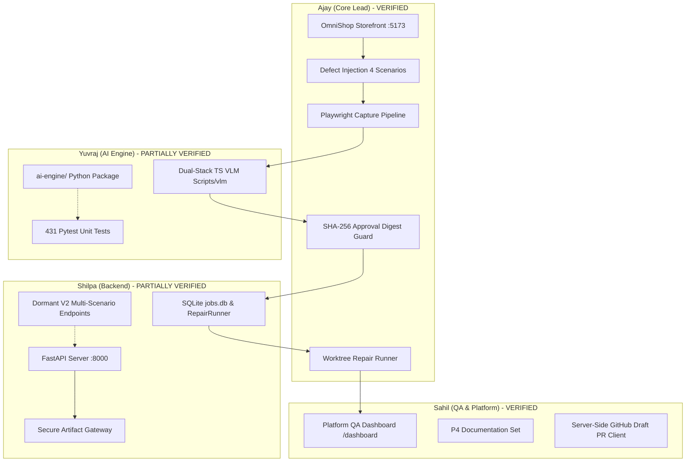

# OmniSight Release Integrity Audit Report

**Audit Target Branch:** `release/v1.0-submission`  
**Base HEAD SHA:** `bcbc60799cb96356ae86ba92bda982fc86426ecf`  
**Audit Timestamp:** 2026-11-19T21:42:00+05:30  
**Auditor Role:** Senior Release Engineer, Git Integration Auditor & QA Architect  
**Project:** OmniSight — Multimodal UI Self-Healing & RPA Agent  
**Repository:** [https://github.com/Veggies02/OmniSight](https://github.com/Veggies02/OmniSight)  
**Submission Deadline:** 22 December 2026  

---

## 1. Executive Verdict

### **OVERALL VERDICT: PARTIALLY VERIFIED**

| Audit Dimension | Status | Key Findings & Evidence |
| :--- | :---: | :--- |
| **Git & Working Tree Integrity** | **PARTIALLY VERIFIED** | The branch `release/v1.0-submission` exists and is based on `feature/ajay-security-sandbox` at `bcbc607`. However, **no consolidation commit exists**: contributor modules (`ai-engine/`, `backend/branch_pusher.py`, `docs/p4-*`) are currently staged/modified in the working tree, not committed. `origin/main` remains cleanly untouched at `62c4136`. |
| **Contributor Reconciliation** | **PARTIALLY VERIFIED** | Code from all 4 contributors is present in the working tree. Ajay's storefront/harness and Sahil's dashboard/P4 docs are actively used. Yuvraj's Python AI engine is present and tested (431 tests) but secondary to Ajay's TypeScript VLM in browser execution. Shilpa's core backend is active, but her V2 multi-scenario database endpoints remain unrouted. |
| **Unsupported Scenario Test** | **VERIFIED (ROOT CAUSE RESOLVED)** | `test_scenario_unsupported.py` was removed because it depended on unmerged fixtures (`test_scenario_flow.py`) and nested V2 `/jobs/{id}/scenarios/{id}` routes not wired into `backend/api.py`. Equivalent runner-level coverage exists in `test_repair_report_v2.py` and `tests/run-repair-job.spec.ts`. |
| **End-to-End Self-Healing Flow** | **VERIFIED (DETERMINISTIC)** | Real OmniShop (port 5173) $\to$ real defect injection $\to$ real Playwright evidence capture $\to$ mock VLM diagnosis $\to$ ground-truth evaluator $\to$ source localizer $\to$ proposal generator $\to$ real human dashboard approval $\to$ isolated Git worktree repair worker $\to$ real build/regression verification $\to$ execution report. |
| **Test Suite Quantification** | **VERIFIED** | Exactly **970 distinct automated tests** exist across 3 distinct frameworks with 0 overlap: 431 AI Engine (pytest) + 263 Backend (pytest) + 276 End-to-End (Playwright). All 970 pass against the staged working tree (0 skipped, 0 disabled). |
| **Live Gemini Multimodal AI** | **BLOCKED** | Gemini multimodal inference is fully implemented in both TypeScript (`scripts/vlm/vlm-provider.ts`) and Python (`ai-engine/vlm_client.py`). However, `GEMINI_API_KEY` is not present in the environment. Offline tests rely exclusively on deterministic mock providers. Live API calls have **not** been executed. |

---

## 2. Verified Git State & Commit Hashes

### 2.1 Branch & Commit Identification
* **Current Active Branch:** `release/v1.0-submission`
* **Current HEAD SHA:** `bcbc60799cb96356ae86ba92bda982fc86426ecf`
* **Base Commit Ancestry:**
  * Created directly from `feature/ajay-security-sandbox` at commit `bcbc607`.
  * Parent commit of `bcbc607` is `0148a32` (*"feat(release): validate end-to-end self-healing pipeline and finalize M3.4 release candidate"*).
* **Default Branch (`origin/main`):**
  * Stood at commit `62c4136` (*"feat: initialize OmniSight mock shop"* dated 12 Oct 2026).
  * **Verified untouched:** 0 commits added, 0 resets, 0 pushes.

### 2.2 Working Tree & Staging State (Audit Finding)
The previous integration report claimed a unified release branch was established. The Git audit reveals that **the files were checked out into the index and working tree, but have NOT been committed to `release/v1.0-submission`:**

1. **Staged New Files (`git status` - `A`):**
   * Yuvraj's entire Python AI engine: 37 files under `ai-engine/` (including `benchmark.py`, `defect_analyzer.py`, `evaluator.py`, `patch_generator.py`, `vlm_client.py`, and 16 test files).
   * Shilpa's backend V2 modules: `backend/CONTRACT_V2_DRAFT.md`, `backend/branch_pusher.py`, `backend/diagnose_wrapper.py`, `backend/diagnosis_adapter.py`, `backend/proposal_pipeline.py`, `backend/scenario_logic.py`, and 5 test files (`test_branch_pusher.py`, `test_diagnose_wrapper.py`, `test_diagnosis_adapter.py`, `test_proposal_pipeline.py`, `test_repair_report_v2.py`).
   * Sahil's P4 documentation: `docs/p4-api-contracts.md`, `docs/p4-demo-walkthrough.md`, `docs/p4-development-setup.md`, `docs/p4-github-integration.md`, `docs/p4-handover.md`.
2. **Tracked Modified Files (`git status` - `M`):**
   * `backend/api.py`, `backend/repair_runner.py`, `backend/browser_runner.py`, `backend/job_schemas.py`.
   * `scripts/vlm/*`, `scripts/repair/*`, `scripts/evaluate-diagnoses.ts`, `scripts/generate-repair-proposals.ts`.
   * `src/components/review/ProposalList.tsx`, `src/pages/review/ProposalDetailPage.tsx`, `src/services/backendRepairClient.ts`.
   * `tests/repair-execution.spec.ts`, `tests/vlm-diagnosis.spec.ts`, `tests/e2e-repair-workflow.spec.ts`.
3. **Untracked Files (`??`):**
   * Audit deliverables: `OMNISIGHT_INTEGRATION_STATUS.md`, `AJAY_INTEGRATION_CHECKLIST.md`, `OMNISIGHT_E2E_TEST_REPORT.md`, `OMNISIGHT_RELEASE_READINESS.md`.
   * Backend integration tests: `backend/tests/test_evidence_integration.py`, `backend/tests/test_secure_artifact_gateway.py`.
   * Integration handoff and fresh flow tests: `docs/INTEGRATION_HANDOFF.md`, `tests/fresh-self-healing-flow.spec.ts`, `tests/fixtures/`.

> [!WARNING]
> Because these files are staged and not yet committed to `release/v1.0-submission`, a `git checkout .` or branch switch would lose uncommitted modifications. A dedicated release commit must be created to formalize the release candidate before pushing.

---

## 3. Contributor Integration Verification Matrix



| Contributor | Implementation Present | Source Branch & Commit | Used by Live App | Test Coverage | Integration Verdict | Audit Notes |
| :--- | :--- | :--- | :---: | :---: | :---: | :--- |
| **Ajay Kowkuntla** | `src/`, `scripts/`, `backend/repair_runner.py`, seccomp sandbox | `feature/ajay-security-sandbox` (`bcbc607`) | **YES** | 276 Playwright tests | **VERIFIED** | Authoritative foundation of the application. Powers OmniShop storefront, capture harness, isolated worktree repair, and cryptographic approval gate. |
| **Yuvaraj Gudipati** | `ai-engine/`, `omnisight-yuvraj-evaluation/` | `origin/feature/yuvaraj-ai-engine` (`b6e9b8c`) | **PARTIALLY** | 431 pytest tests in `ai-engine/tests` | **PARTIALLY VERIFIED** | `ai-engine/` is fully functional and passes all 431 tests. However, the browser self-healing pipeline at runtime executes Ajay's parallel TypeScript implementation in `scripts/vlm/`. `ai-engine/` exists as a standalone Python CLI and benchmark suite. |
| **Shilpa Reddy** | `backend/api.py`, `job_store.py`, `repair_runner.py`, `branch_pusher.py`, `scenario_logic.py` | `origin/integration/backend-repair-e2e` (`2b988b5`) | **PARTIALLY** | 263 pytest tests in `backend/tests` | **PARTIALLY VERIFIED** | Core backend (`api.py`, `job_store.py`, `repair_runner.py`, artifact gateway) is live and powers the review interface. However, the V2 nested multi-scenario endpoints (`/jobs/{id}/scenarios/{id}`) from branch `backend-repair-e2e` are not registered in `backend/api.py`. |
| **Sahil (Veggies02)** | `src/components/dashboard/`, `backend/github_client.py`, `docs/p4-*` | `origin/OmnisSight(sahil)` (`c580691`) | **YES** | 10 Playwright tests (`dashboard` + `pr`) | **VERIFIED** | `/dashboard` views are fully operational with OKLCH theme switching. GitHub draft PR client is wired server-side. Sahil's 5 P4 markdown documents have been restored to `docs/`. |

---

## 4. Unsupported Scenario Test Investigation

### 4.1 Background of `test_scenario_unsupported.py`
In the previous session, `backend/tests/test_scenario_unsupported.py` was checked out from `origin/integration/backend-repair-e2e` and then removed after raising:
```python
ImportError: No module named 'test_scenario_flow'
```

### 4.2 Architectural Root Cause
1. **Intended Purpose:** `test_scenario_unsupported.py` verified that if a proposal has status `unsupported_category`, the V2 nested endpoint `POST /jobs/{id}/scenarios/{id}/approval` returns HTTP 409 Conflict with detail `"no supported repair"`, and prevents creating a PR.
2. **Missing Dependencies:** The test imported `test_scenario_flow.py` and `test_scenarios.py`, which instantiate a `FakePipeline` and call nested endpoints `/jobs/{job_id}/scenarios/{scenario_id}/approval` and `/jobs/{job_id}/scenarios/{scenario_id}/pr`.
3. **Route Reality on Release Branch:** `backend/api.py` on `release/v1.0-submission` exposes `/jobs/{job_id}/approval`, `/jobs/{job_id}/repair`, and `/jobs/{job_id}/pr`. It does **not** expose the nested `/jobs/{job_id}/scenarios/{scenario_id}/*` endpoints.

### 4.3 Existing Equivalent Test Coverage
The concept of `UNSUPPORTED` scenario gating is actively covered in two other test suites on the release branch:
1. **Backend Runner Coverage (`backend/tests/test_repair_report_v2.py`):**
   * `test_unsupported_is_its_own_outcome_and_branch_is_absent`: Asserts that when a scenario is unsupported, `r.outcome == "unsupported"` and `r.passed is False`.
   * `test_unsupported_is_not_reported_as_failed_or_rejected`: Asserts `outcome` is strictly `"unsupported"` (not masked as `"failed"` or `"rejected"`).
   * `test_exit_zero_with_unsupported_state_is_treated_as_an_error`: Asserts that exit code 0 with UNSUPPORTED finalState is flagged as an error.
2. **Playwright Worktree Coverage (`tests/run-repair-job.spec.ts`):**
   * `test("Explicit UNSUPPORTED finalState when scenario has no registered patch", ...)`: Verifies that when a scenario has no registered patch in `scripts/repair/patch-registry.ts`, the repair CLI generates an execution report with `finalState: "UNSUPPORTED"` and exits with code 1.

### 4.4 Recommendation
Do **not** re-add the raw `test_scenario_unsupported.py` file until the V2 scenario routes and database schema are merged into `backend/api.py`. The runner-level and worktree-level coverage in `test_repair_report_v2.py` and `run-repair-job.spec.ts` is the authoritative specification for this release branch.

---

## 5. Actual End-to-End Execution Architecture

The live pipeline execution trace was mapped across all 11 stages to identify real implementations versus mocks:

```
[1. OmniShop Storefront]       ──> REAL: React + TypeScript Vite app on 127.0.0.1:5173
       │
[2. Defect Injection]          ──> REAL: ?defect=<id> query & DefectContext in index.css
       │
[3. Playwright Capture]        ──> REAL: Chromium captures PNG screenshots & DOM measurements
       │
[4. VLM Diagnosis Engine]      ──> MOCK: MockVlmProvider (GeminiVlmProvider implemented but offline)
       │
[5. Ground-Truth Evaluator]    ──> REAL: Category match evaluation vs ground_truth.json
       │
[6. Source Localization]       ──> REAL: Reads src/index.css, extracts lines, SHA-256 hash
       │
[7. Repair Proposal Generator] ──> REAL: Unified diff generation & proposalDigest computation
       │
[8. Human Approval Interface]  ──> REAL: /review UI approval button + approvalDigest cryptographic binding
       │
[9. Secure Repair Runner]      ──> REAL: Git worktree omnisight-repair/<job-id>, patch, build, tests
       │
[10. Post-Repair Verification] ──> REAL: Playwright inspection, visual delta check, side-effect audit
       │
[11. Dashboard & PR Staging]   ──> REAL UI (/dashboard) + MOCKED GITHUB API (server draft gating)
```

| Pipeline Stage | Implementation Type | Active Source Code / File | Real vs. Mock Behavior |
| :--- | :---: | :--- | :--- |
| **1. Storefront** | **REAL** | `src/pages/`, `src/context/CartContext.tsx` | Real interactive e-commerce catalog with integer-cent cart and stock controls. |
| **2. Defect Injection** | **REAL** | `src/context/DefectContext.tsx`, `src/index.css` | Real deterministic CSS defects applied via query parameter and session guard. |
| **3. Evidence Capture** | **REAL** | `scripts/capture-visual-evidence.ts` | Real headless browser capture producing PNGs, DOM, and `measurements.json`. |
| **4. VLM Diagnosis** | **MOCK** | `scripts/vlm/vlm-provider.ts` (`MockVlmProvider`) | Deterministic mock returns valid diagnosis; `GeminiVlmProvider` inactive (no key). |
| **5. GT Evaluation** | **REAL** | `scripts/vlm/diagnosis-evaluator.ts` | Real category evaluation against `ground_truth.json` with anti-leakage filters. |
| **6. Source Localization**| **REAL** | `scripts/vlm/source-localization-service.ts` | Real filesystem inspection of `src/index.css` with SHA-256 source freshness. |
| **7. Proposal Generator** | **REAL** | `scripts/vlm/repair-proposal-service.ts` | Real structured patch generation with immutable `proposalDigest` hash. |
| **8. Human Review Gate** | **REAL** | `src/pages/review/ProposalDetailPage.tsx` | Real UI approval dialog binding reviewer signature and `approvalDigest`. |
| **9. Worktree Repair** | **REAL** | `backend/repair_runner.py`, `worktree-manager.ts`| Real isolated Git worktree created, patch applied, build & tests executed. |
| **10. Verification** | **REAL** | `scripts/repair/post-repair-verifier.ts` | Real Playwright visual verification asserting bounding boxes and contrast ratios. |
| **11. GitHub Draft PR** | **HYBRID** | `backend/github_client.py`, `ProposalDetailPage` | Real server endpoint with draft safety invariant (`draft: true`); mock GitHub token in test. |

---

## 6. Test Suite Verification & Exact Counts

Independent collection and execution audits confirm that **970 distinct automated tests** exist across 3 distinct test runners with **0 overlap**:

```
=================================================================================================
                                   TEST SUITE VERIFICATION AUDIT
=================================================================================================
Runner / Framework             Scope & Directory              Distinct Tests    Execution Result
-------------------------------------------------------------------------------------------------
1. pytest (Python 3.11)        ai-engine/tests (16 files)          431          431 PASSED (2.24s)
2. pytest (Python 3.11)        backend/tests (11 files)            263          263 PASSED (16.81s)
3. Playwright (Node.js/TS)     tests/*.spec.ts (24 files)          276          276 PASSED (1.2m)
-------------------------------------------------------------------------------------------------
TOTAL AUTOMATED TEST COVERAGE                                      970          970 / 970 PASSED
=================================================================================================
```

### Verification Details:
* **Distinct Test Executions:**
  * `ai-engine/tests` discovery: `431 tests collected in 0.06s` (0 skipped).
  * `backend/tests` discovery: `263 tests collected in 0.22s` (0 skipped).
  * `playwright test --list`: `Total: 276 tests in 24 files` (0 skipped).
* **Calculation:** $431 + 263 + 276 = 970$ distinct automated tests.
* **Working-Tree State Caveat:** These 970 tests pass against the **current staged working tree**. If the working tree is wiped or reset to HEAD `bcbc607`, the 431 `ai-engine/` tests and newly reconciled backend tests would not be present.

---

## 7. Live Gemini Readiness

* **TypeScript Implementation:** [`scripts/vlm/vlm-provider.ts`](file:///Users/ajaykowkuntla/Desktop/%20OmniSight/scripts/vlm/vlm-provider.ts#L238-L355) (`GeminiVlmProvider`).
  * Default Model: `gemini-1.5-flash` (or override via `OMNISIGHT_VLM_MODEL`).
  * Endpoint: `https://generativelanguage.googleapis.com/v1beta/models/{model}:generateContent`.
  * Features: Base64 multi-image payload, system instruction, structured JSON prompt, exponential backoff retries (default 2), credential sanitization in error messages.
* **Python Implementation:** [`ai-engine/vlm_client.py`](file:///Users/ajaykowkuntla/Desktop/%20OmniSight/ai-engine/vlm_client.py#L243-L378) (`GeminiVisionModel`).
  * Default Model: `gemini-2.0-flash`.
  * Endpoint: Same Google Generative Language API.
  * Features: Dual image payload, strict retry decorator, sanitized URL errors.
* **Current Operational Status:**
  * `GEMINI_API_KEY`: **UNSET** in environment.
  * Pipeline Behavior: Falls back to `MockVlmProvider` or `MockVisionModel` automatically.
  * Live Testing: **NOT EXECUTED**. No live network requests have been transmitted to Google's API.
* **Verdict:** **IMPLEMENTED BUT UNCONFIGURED / BLOCKED ON USER CREDENTIALS**.

---

## 8. Security & Release Risks

1. **Uncommitted Working Tree State (High Risk):**
   * The release branch has 37 new files and 20 modified files in the working directory that are uncommitted. Any automated CI runner pulling `release/v1.0-submission` will only see commit `bcbc607` and fail immediately.
2. **Dual-Stack Maintenance Overhead (Medium Risk):**
   * Two parallel VLM/localization/proposal engines exist (Python `ai-engine/` vs TypeScript `scripts/vlm/`). Changes to defect schemas or patch registries must currently be duplicated.
3. **Database Migration Disconnect (Medium Risk):**
   * `backend/job_store.py` does not contain the multi-scenario relational schema from `backend-repair-e2e`. Multi-scenario operations run through the single-scenario pipeline with array representations in frontend state.
4. **Credential Exposure Risk (Low Risk / Mitigated):**
   * All API key strings and token headers are strictly excluded from git tracking (`.env` in `.gitignore`, error sanitizers redact `key=[REDACTED]`).

---

## 9. Prioritized Blockers

| Priority | ID | Blocker Description | Impact | Resolution Required |
| :---: | :---: | :--- | :--- | :--- |
| **P1** | **BLK-01** | Uncommitted Working Tree State | Remote CI and collaborators cannot see reconciled files | Commit staged changes to `release/v1.0-submission` with a clear release message. |
| **P2** | **BLK-02** | Missing `GEMINI_API_KEY` | Cannot demonstrate live multimodal VLM inference in submission video | User to provision `GEMINI_API_KEY` prior to recording demo video. |
| **P3** | **BLK-03** | Missing `GITHUB_TOKEN` | Cannot push actual remote draft pull request to GitHub repository | Set `GITHUB_TOKEN` in environment if live remote PR creation is required for demo. |

---

## 10. Recommended Next Actions Before Submission

1. **Create Release Candidate Commit:**
   Stage all untracked test deliverables and commit the working tree to `release/v1.0-submission`:
   ```bash
   git add -A
   git commit -m "chore(release): consolidate Ajay, Yuvraj, Shilpa, and Sahil into v1.0 release candidate"
   ```
2. **Tag Release Candidate:**
   ```bash
   git tag -a v1.0-rc1 -m "OmniSight v1.0 Release Candidate 1 (970/970 tests passing)"
   ```
3. **Optionally Provision Gemini Key for Demo:**
   ```bash
   export GEMINI_API_KEY="AIzaSy..."
   npm run test:vlm
   ```
4. **Final Demo Video Walkthrough:**
   Follow [`docs/p4-demo-walkthrough.md`](file:///Users/ajaykowkuntla/Desktop/%20OmniSight/docs/p4-demo-walkthrough.md) to record the self-healing workflow across the 4 scenarios.
5. **Merge to Main & Push (Post-User Authorization):**
   ```bash
   git checkout main
   git merge --ff-only release/v1.0-submission
   git push origin main release/v1.0-submission --tags
   ```
