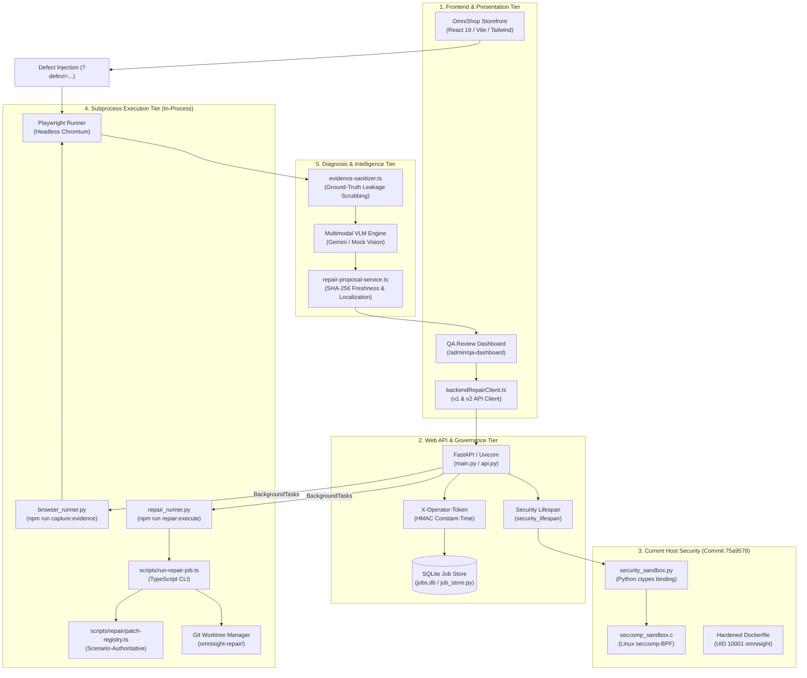
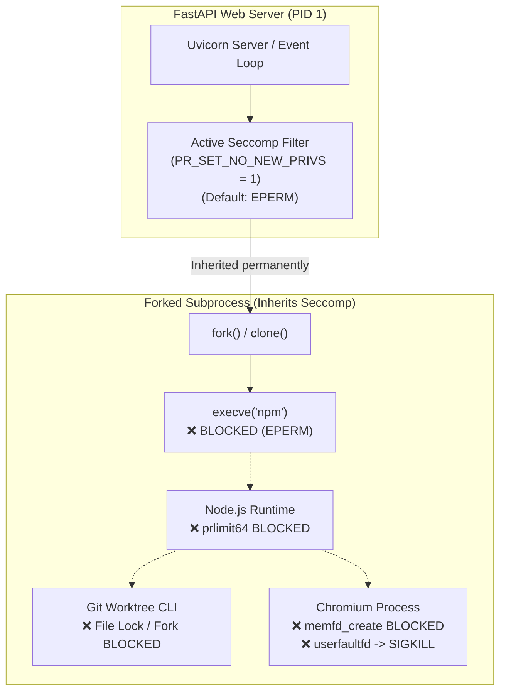
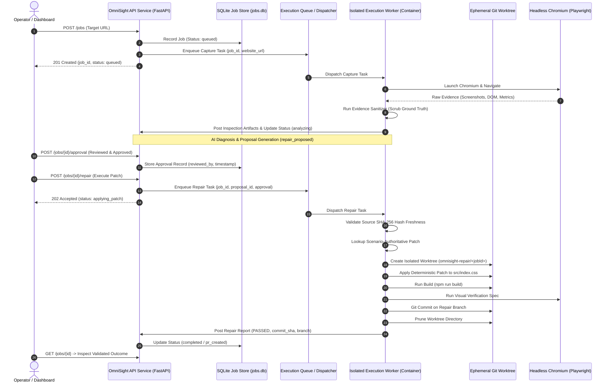
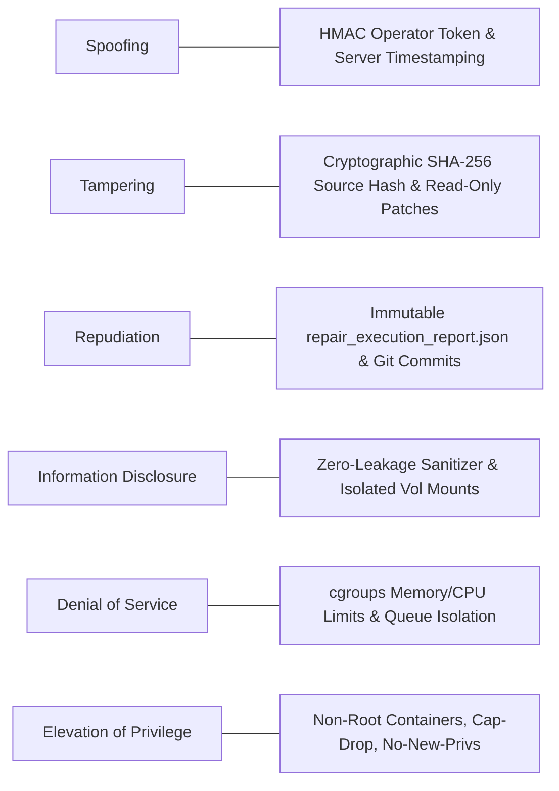
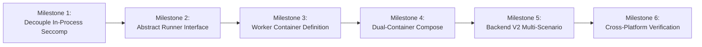
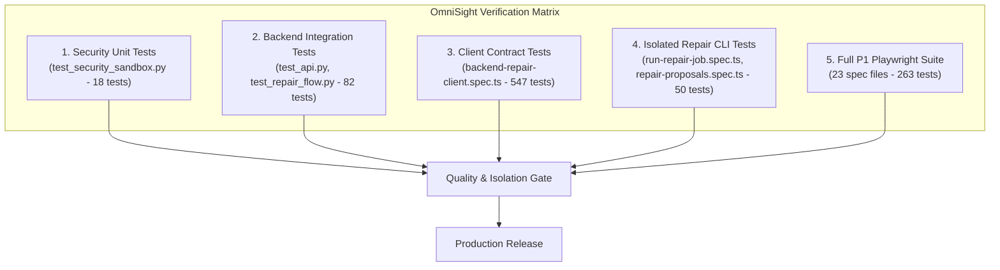

# OmniSight Security Architecture Audit & Execution Isolation Strategy

**Document:** Comprehensive Security Architecture Audit, Vulnerability Analysis & Execution Isolation Blueprint
**Target Repository:** `Veggies02/OmniSight`
**Current Branch:** `feature/ajay-security-sandbox`
**Base Commit:** [`75a9578`](file:///Users/ajaykowkuntla/Desktop/%20OmniSight) (`feat(security): implement seccomp sandbox hardening`)
**Auditor Roles:** Principal Software Architect, Application Security Engineer, Linux Systems Engineer, Cross-Platform Backend Specialist
**Classification:** Engineering Architecture & Security Specification

---

## 1. Executive Summary

OmniSight is an AI-powered automated visual inspection, diagnosis, and deterministic repair platform for web applications. The platform connects browser-based visual evidence capture (Playwright), multimodal vision-language model diagnosis (VLM), human-in-the-loop (HITL) approval governance, and automated Git-based repair execution into a continuous quality assurance loop.

This audit evaluates the system's security posture following commit [`75a9578`](file:///Users/ajaykowkuntla/Desktop/%20OmniSight), which implemented an OS-level Linux seccomp-BPF filter and container hardening.

### Primary Audit Verdict
> [!CAUTION]
> **CRITICAL ARCHITECTURAL CONFLICT IDENTIFIED: The in-process seccomp sandbox installed inside the FastAPI application process inherently breaks downstream execution workloads (Playwright browser capture, Node.js runtime, Git worktree operations, and Vite builds) on Linux production systems.**

While the seccomp implementation in [`seccomp_sandbox.c`](file:///Users/ajaykowkuntla/Desktop/%20OmniSight/seccomp_sandbox.c) and [`security_sandbox.py`](file:///Users/ajaykowkuntla/Desktop/%20OmniSight/security_sandbox.py) succeeds in establishing OS-level system call filtering with strict default-deny semantics for a pure HTTP server, **installing this filter directly into the web application process violates the fundamental security principle of privilege and domain separation**.

Specifically:
1. **System Call Starvation:** The seccomp whitelist in [`seccomp_sandbox.c`](file:///Users/ajaykowkuntla/Desktop/%20OmniSight/seccomp_sandbox.c#L182-L504) omits `__NR_execve`, `__NR_execveat`, `__NR_fork`, `__NR_vfork`, and `__NR_memfd_create`. Under an active Linux seccomp filter, any attempt by FastAPI's `BackgroundTasks` to invoke `subprocess.Popen` in [`browser_runner.py`](file:///Users/ajaykowkuntla/Desktop/%20OmniSight/artifacts/integration-backend/backend/browser_runner.py#L161) (`npm run capture:evidence`) or [`repair_runner.py`](file:///Users/ajaykowkuntla/Desktop/%20OmniSight/artifacts/integration-backend/backend/repair_runner.py#L112) (`npm run repair:execute`) immediately triggers an uncatchable `EPERM` (`PermissionError: [Errno 1] Operation not permitted`).
2. **Inherited Restriction & Browser Crash:** In the Linux kernel, seccomp filters and `PR_SET_NO_NEW_PRIVS` are permanently inherited across `fork()` and `execve()`. Even if `execve` were permitted, Chromium's multi-process zygote sandbox, GPU process, and memory-mapped shared buffers (`/dev/shm`, `memfd_create`, `userfaultfd`) would be subjected to the parent's restrictive filter, causing headless browser crashes.
3. **Blast Radius & Denial of Service:** Long-running repair jobs (timeouts up to 900 seconds) and browser automation executing inside the FastAPI process thread pool starve Uvicorn's event loop, risking server unresponsiveness and out-of-memory (OOM) crashes that terminate the entire public web service.
4. **Cross-Platform Asymmetry:** Linux seccomp is kernel-dependent and does not execute natively on macOS Darwin or Windows hosts. Relying on host-level seccomp for execution security leaves non-Linux environments unprotected while introducing false security assumptions.

### Core Strategic Recommendation
OmniSight must transition from an **in-process monolithic sandbox** to an **asynchronous, containerized execution worker architecture**:
- **FastAPI Web Service:** Remains a pure, lightweight REST API responsible solely for job intake, SQLite state management, operator authentication, and telemetry. It runs in a hardened container with strict network controls and standard runtime privileges, without in-process seccomp interference.
- **Dedicated Execution Workers:** Browser automation (Playwright) and repair pipeline execution (Git worktree, patch application, visual validation) move to dedicated, isolated worker containers or distinct unprivileged subprocess pools with tailored, workload-specific security profiles, independent resource limits (cgroups v2), and scratch filesystem mounts.

---

## 2. Existing Architecture & Repository Discovery

OmniSight consists of five distinct architectural tiers spanning TypeScript (React 19 / Vite), Python (FastAPI / Uvicorn), and native systems code (C / Seccomp).

### Detailed Component Inventory

| Component | Files | Primary Responsibility | Observed Runtime Characteristics |
| :--- | :--- | :--- | :--- |
| **Storefront** | [`src/App.tsx`](file:///Users/ajaykowkuntla/Desktop/%20OmniSight/src/App.tsx), [`src/data/defects.ts`](file:///Users/ajaykowkuntla/Desktop/%20OmniSight/src/data/defects.ts) | Mock e-commerce storefront (`OmniShop`) with 4 deterministic UI defect injection scenarios | Pure client-side React 19 app; defects toggled via query string `?defect=<id>`. |
| **QA Dashboard** | [`src/components/ReviewDashboard.tsx`](file:///Users/ajaykowkuntla/Desktop/%20OmniSight/src/components/ReviewDashboard.tsx) | Review evidence, inspect model proposals, approve/reject patches, monitor repair status | Interacts with FastAPI backend via [`src/services/backendRepairClient.ts`](file:///Users/ajaykowkuntla/Desktop/%20OmniSight/src/services/backendRepairClient.ts). |
| **Web API Service** | [`main.py`](file:///Users/ajaykowkuntla/Desktop/%20OmniSight/main.py), [`backend/api.py`](file:///Users/ajaykowkuntla/Desktop/%20OmniSight/artifacts/integration-backend/backend/api.py) | Job intake, state tracking, webhook ingestion, approval gating, and status polling | FastAPI application running on Uvicorn; persists state to SQLite (`jobs.db`). |
| **Backend V2** | [`backend/CONTRACT_V2_DRAFT.md`](file:///Users/ajaykowkuntla/Desktop/%20OmniSight/backend/CONTRACT_V2_DRAFT.md), [`src/services/backendRepairClient.ts`](file:///Users/ajaykowkuntla/Desktop/%20OmniSight/src/services/backendRepairClient.ts#L440-L581) | Multi-scenario job model, independent scenario approvals, sequential repairs, server-side Draft PR creation | Client implemented; backend contract specification agreed; supports fine-grained per-scenario repair tracking. |
| **Security Sandbox** | [`seccomp_sandbox.c`](file:///Users/ajaykowkuntla/Desktop/%20OmniSight/seccomp_sandbox.c), [`security_sandbox.py`](file:///Users/ajaykowkuntla/Desktop/%20OmniSight/security_sandbox.py) | Host-level system call filtering, C ctypes binding, fail-closed enforcement | Uses Linux seccomp-BPF with default `EPERM`, 85 whitelisted syscalls, 27 blocked syscalls. |
| **Container Hardening** | [`Dockerfile`](file:///Users/ajaykowkuntla/Desktop/%20OmniSight/Dockerfile), [`entrypoint.sh`](file:///Users/ajaykowkuntla/Desktop/%20OmniSight/entrypoint.sh) | Multi-stage containerization, non-root user `omnisight` (UID 10001), PID 1 signal forwarding | Drops build tools from runtime; enforces non-root execution check in shell entrypoint. |
| **Browser Automation** | [`scripts/capture-visual-evidence.ts`](file:///Users/ajaykowkuntla/Desktop/%20OmniSight/scripts/capture-visual-evidence.ts), [`backend/browser_runner.py`](file:///Users/ajaykowkuntla/Desktop/%20OmniSight/artifacts/integration-backend/backend/browser_runner.py) | Headless Chromium capture of visual screenshots, DOM excerpts, computed CSS styles | Spawned via `subprocess.Popen` from FastAPI background tasks. |
| **Evidence Sanitizer** | [`scripts/vlm/evidence-sanitizer.ts`](file:///Users/ajaykowkuntla/Desktop/%20OmniSight/scripts/vlm/evidence-sanitizer.ts) | Prevents model bias and benchmark leakage by scrubbing ground-truth identifiers | Scrubs `?defect=`, `data-defect-*`, internal CSS classes, machine paths, and comments. |
| **Proposal Service** | [`scripts/vlm/repair-proposal-service.ts`](file:///Users/ajaykowkuntla/Desktop/%20OmniSight/scripts/vlm/repair-proposal-service.ts) | Transforms VLM output into structured proposal JSON with cryptographic file hashing | Calculates 64-character SHA-256 hash of `src/index.css` to detect stale proposals. |
| **Patch Registry** | [`scripts/repair/patch-registry.ts`](file:///Users/ajaykowkuntla/Desktop/%20OmniSight/scripts/repair/patch-registry.ts) | Deterministic patch repository mapping scenario IDs to pre-vetted code diffs | Strictly scenario-authoritative (`AUD-SEC-01`); rejects unknown scenarios with `UNSUPPORTED`. |
| **Repair Engine** | [`scripts/run-repair-job.ts`](file:///Users/ajaykowkuntla/Desktop/%20OmniSight/scripts/run-repair-job.ts), [`backend/repair_runner.py`](file:///Users/ajaykowkuntla/Desktop/%20OmniSight/artifacts/integration-backend/backend/repair_runner.py) | Isolated Git worktree execution, patch application, `npm run build`, visual verification | Executes in `artifacts/repair-worktrees/<jobId>` on ephemeral branch `omnisight-repair/<jobId>`. |

---

## 3. Audit of Existing Security Implementation (Commit 75a9578)

A line-by-line inspection of commit [`75a9578`](file:///Users/ajaykowkuntla/Desktop/%20OmniSight) reveals specific strengths alongside critical architectural vulnerabilities.

### 3.1 Seccomp Implementation Correctness
- **Mechanism:** Implemented in [`seccomp_sandbox.c`](file:///Users/ajaykowkuntla/Desktop/%20OmniSight/seccomp_sandbox.c#L583-L640) using `libseccomp` (`seccomp_init(SCMP_ACT_ERRNO(EPERM))`) with raw BPF fallback (`prctl(PR_SET_SECCOMP, SECCOMP_MODE_FILTER, &prog)`).
- **Prerequisite Enforcement:** Correctly sets `prctl(PR_SET_NO_NEW_PRIVS, 1, 0, 0, 0)` at line 596 prior to filter installation, preventing privilege escalation through `setuid` binaries.
- **Default Action:** Correctly employs `SCMP_ACT_ERRNO(EPERM)` rather than `SCMP_ACT_KILL_PROCESS` as the default rule, preventing instant kernel crashes for benign unrecognized syscalls while returning clean error codes.

### 3.2 Syscall Whitelist & Omissions Analysis
The whitelist in [`seccomp_sandbox.c`](file:///Users/ajaykowkuntla/Desktop/%20OmniSight/seccomp_sandbox.c#L182-L504) contains 85 system calls focused exclusively on basic Python runtime, networking, and SQLite I/O.

However, critical system calls necessary for subprocess orchestration and browser automation are **missing**:

| Missing System Call | Impacted Subsystem | Concrete Failure Mode | Severity |
| :--- | :--- | :--- | :--- |
| `__NR_execve` `__NR_execveat` | Subprocess Execution ([`browser_runner.py`](file:///Users/ajaykowkuntla/Desktop/%20OmniSight/artifacts/integration-backend/backend/browser_runner.py#L161), [`repair_runner.py`](file:///Users/ajaykowkuntla/Desktop/%20OmniSight/artifacts/integration-backend/backend/repair_runner.py#L112)) | Any call to `subprocess.Popen` in Python invokes `fork()` followed by `execve()`. Without `execve`, the kernel returns `EPERM`. Python raises `PermissionError: [Errno 1] Operation not permitted`, completely disabling evidence capture and repair execution. | **CRITICAL** |
| `__NR_fork` `__NR_vfork` | Process Creation (Python runtime) | Legacy glibc or platform process spawning primitives fail with `EPERM`. | **HIGH** |
| `__NR_memfd_create` | Headless Playwright / Chromium | Modern Chromium utilizes `memfd_create` to allocate shared memory segments (`/dev/shm`) for inter-process image rasterization and DOM snapshot transport. Fails with `EPERM`, causing browser render crash. | **CRITICAL** |
| `__NR_prlimit64` | Node.js Runtime | Node.js (executing `capture:evidence` and `repair:execute`) queries process resource limits during bootstrap. Fails with `EPERM`, terminating Node.js. | **HIGH** |
| `__NR_seccomp` | Chromium Browser Sandbox | Chromium spawns a zygote process that attempts to install its own internal seccomp sandbox via `prctl(PR_SET_SECCOMP)` or `syscall(__NR_seccomp)`. Lacking `__NR_seccomp`, Chromium fails to initialize its sandbox and refuses to launch unless insecurely run with `--no-sandbox`. | **CRITICAL** |
| `__NR_unshare` `__NR_setns` | Linux Container Namespaces | Process isolation primitives required by container runtimes and Chromium sandboxing fail. | **HIGH** |

### 3.3 Dangerous Syscall Restrictions
The implementation in [`seccomp_sandbox.c`](file:///Users/ajaykowkuntla/Desktop/%20OmniSight/seccomp_sandbox.c#L80-L180) explicitly targets 27 dangerous syscalls with `SCMP_ACT_KILL_PROCESS`:
- Process injection: `ptrace`, `process_vm_readv`, `process_vm_writev`, `vmsplice`
- Kernel & system reboot: `kexec_load`, `kexec_file_load`, `reboot`
- Filesystem breakout: `mount`, `umount2`, `pivot_root`, `chroot`
- Identity tampering: `setuid`, `setgid`, `setresuid`, `setresgid`, `setreuid`, `setregid`
- Kernel modules: `init_module`, `finit_module`, `delete_module`
- Exploit primitives: `bpf`, `userfaultfd`, `iopl`, `ioperm`, `swapon`, `swapoff`, `acct`

**Audit Finding:** `userfaultfd` is mapped to `SCMP_ACT_KILL_PROCESS`. While effective against kernel exploits (such as dirty cow / heap grooming), modern Chromium features memory management probes that touch `userfaultfd` or user namespaces. Under this policy, touching this syscall results in immediate `SIGKILL` / `SIGSYS` termination of the entire container process tree.

### 3.4 Python ctypes Integration
- Implemented in [`security_sandbox.py`](file:///Users/ajaykowkuntla/Desktop/%20OmniSight/security_sandbox.py#L102-L141).
- Provides explicit ctypes function signatures (`argtypes`, `restype`).
- Includes dynamic library compilation fallback ([`security_sandbox.py`](file:///Users/ajaykowkuntla/Desktop/%20OmniSight/security_sandbox.py#L67-L99)) which compiles `seccomp_sandbox.c` on-the-fly if the shared library is not pre-installed.
- *Risk:* In a hardened production runtime, dynamic on-the-fly compilation requires a C compiler (`gcc`), which violates container minimal-attack-surface rules. The `Dockerfile` correctly resolves this by compiling in a builder stage and copying the compiled `.so` to `/usr/local/lib`.

### 3.5 FastAPI Lifespan & Fail-Closed Behavior
- Integrated in [`main.py`](file:///Users/ajaykowkuntla/Desktop/%20OmniSight/main.py#L44-L68) via `@asynccontextmanager async def security_lifespan(app: FastAPI)`.
- If `OMNISIGHT_ENFORCE_SANDBOX=1` (or `SECURITY_SANDBOX_REQUIRED=1`), failure to load or activate the seccomp filter raises `SecuritySandboxInitializationError`, immediately terminating application startup. This is verified by test [`test_fail_closed_on_unsupported_host_without_bypass`](file:///Users/ajaykowkuntla/Desktop/%20OmniSight/test_security_sandbox.py#L225).
- If running in local development on macOS/Windows, setting `OMNISIGHT_ALLOW_DEV_SANDBOX_BYPASS=1` logs security warnings and permits permissive execution.

### 3.6 Container Security Configuration
- [`Dockerfile`](file:///Users/ajaykowkuntla/Desktop/%20OmniSight/Dockerfile): Multi-stage build separates compiler toolchain (`builder`) from minimal runtime (`runtime`).
- Container user: Explicitly creates unprivileged user `omnisight` (UID 10001, GID 10001) with shell `/sbin/nologin`.
- Permissions: `/entrypoint.sh` is mode `0755`, `/usr/local/lib/seccomp_sandbox.so` is mode `0644`.
- [`entrypoint.sh`](file:///Users/ajaykowkuntla/Desktop/%20OmniSight/entrypoint.sh): Uses `set -eu`, traps signals, checks `[ "$(id -u)" -eq 0 ]` (aborts if executed as root), and executes `exec "$@"` for PID 1 signal propagation.

---

## 4. Workload Security & Interference Assessment

Installing seccomp in the FastAPI parent process creates direct operational conflicts with OmniSight's automated workloads.

### 4.1 FastAPI & Asyncio / Uvicorn Compatibility
- **Observed Behavior:** FastAPI with Uvicorn functions normally for pure HTTP request/response cycles under the whitelisted syscalls (sockets, epoll, read/write, nanosleep).
- **Concurrency Bottleneck:** OmniSight's background tasks ([`backend/api.py`](file:///Users/ajaykowkuntla/Desktop/%20OmniSight/artifacts/integration-backend/backend/api.py#L187)) dispatch `run_inspection` and `run_repair` into Starlette's threadpool executor. When a repair job executes `npm run build` or Playwright tests, it monopolizes host CPU cores and memory, degrading API latency for dashboard users.

### 4.2 Playwright & Browser Subprocess Incompatibility
- **Direct Conflict:** [`browser_runner.py`](file:///Users/ajaykowkuntla/Desktop/%20OmniSight/artifacts/integration-backend/backend/browser_runner.py#L161) calls `subprocess.Popen([npm, "run", "capture:evidence"])`.
- **System Call Blocker:** In a live Linux environment with seccomp active:
  1. `execve` returns `EPERM`.
  2. If `execve` is whitelisted, Node.js triggers `prlimit64` (returns `EPERM`).
  3. When Node launches Chromium, Chromium calls `memfd_create` for IPC shared memory (returns `EPERM`).
  4. Chromium probes user namespaces and seccomp filters (returns `EPERM` or `SIGKILL`).
- **Conclusion:** Playwright **cannot run** inside a process that has been restricted by FastAPI's web seccomp filter.

### 4.3 Repair Execution Pipeline Incompatibility
- **Direct Conflict:** [`repair_runner.py`](file:///Users/ajaykowkuntla/Desktop/%20OmniSight/artifacts/integration-backend/backend/repair_runner.py#L112) calls `subprocess.Popen([npm, "run", "repair:execute", "--", ...])`.
- **Subprocess Hierarchy:**
  - `npm` -> `node` -> `scripts/run-repair-job.ts` -> `git worktree add` -> `vite build` (`esbuild` Go binary) -> `npx playwright test` -> `chromium`.
- **Failure Points:**
  - `git worktree add` creates directories and branch refs outside the immediate workspace; requires file locking (`flock`) and process branching.
  - `esbuild` utilizes native Go threading (`clone3` with custom flags, `mincore`), triggering `EPERM` if any thread-synchronization syscall deviates from the whitelist.
  - Total repair duration is up to 15 minutes. Holding an in-process thread for 15 minutes while compiling and running browsers in the web service process is an anti-pattern that leads to worker starvation and API timeouts.

---

## 5. Cross-Platform Compatibility Matrix

OmniSight must remain accessible and functional on macOS, Windows, and Linux across its four operational domains.

| Domain | Linux (Ubuntu / Debian / RHEL) | macOS (Darwin 24.x) | Windows 11 (x64 / ARM64) |
| :--- | :--- | :--- | :--- |
| **A. Web Application** (OmniShop & Dashboard) | Node.js 18+ / Vite / Nginx / Chromium | Node.js 18+ / Vite / Safari / Chrome | Node.js 18+ / Vite / Edge / Chrome |
| **B. Backend API Service** (FastAPI / SQLite) | Python 3.11+ / Uvicorn (Native or Docker) | Python 3.11+ / Uvicorn (Native or Docker) | Python 3.11+ / Uvicorn (Native or WSL2) |
| **C. Execution Workloads** (Playwright, Git, Builds) | Native Linux or Docker Container | Native macOS or Docker (via Colima/Docker Desktop) | Native Windows (`npm.cmd`) or WSL2 / Docker |
| **D. Security Enforcement** (Isolation Primitive) | **Linux Seccomp-BPF**, Landlock, Namespaces, cgroups v2 | **macOS Seatbelt (`sandbox-exec`)**, App Sandbox, POSIX DAC | **Windows Job Objects**, AppContainer, Restricted Tokens |

### Key Cross-Platform Findings:
1. **Linux Seccomp is Non-Portable:** Calling `prctl(PR_SET_SECCOMP)` on macOS or Windows returns `-1` (`ENOSYS`). Linux seccomp cannot serve as the universal cross-platform sandbox.
2. **Path Separator & Command Resolvers:** [`scripts/repair/repair-execution-service.ts`](file:///Users/ajaykowkuntla/Desktop/%20OmniSight/scripts/repair/repair-execution-service.ts#L27-L31) correctly implements `resolveNpmCommand` to use `npm.cmd` on Windows and `npm` on POSIX. Any execution architecture must preserve this cross-platform command resolution.
3. **Container as the Normalizing Layer:** Docker / OCI containers provide a completely uniform Linux runtime across macOS (Docker Desktop/Colima), Windows (WSL2), and Linux bare-metal.

---

## 6. Architecture Comparison

To determine the production-ready execution strategy, we evaluate three architectural models:

```mermaid
flowchart TD
    subgraph Arch1["Architecture 1: Existing Monolithic In-Process Sandbox"]
        API1["FastAPI Backend\n(Port 8000)"]
        Sec1["In-Process Seccomp\n(Shared Process Memory)"]
        Sub1["Subprocesses: Playwright, Git, Vite\n(Inherits Filter & Crashes)"]
        API1 --- Sec1 --- Sub1
    end

    subgraph Arch2["Architecture 2: Decoupled Local Worker Process"]
        API2["FastAPI Backend\n(Unrestricted for Subprocess Dispatch)"]
        Pipe["IPC / Process Pipe / Domain Socket"]
        Worker2["Independent Worker Process\n(Applies Worker Seccomp Post-Fork)"]
        API2 --> Pipe --> Worker2
    end

    subgraph Arch3["Architecture 3: Dedicated Containerized Execution Service"]
        API3["Container: omnisight-api\n(Pure REST, SQLite, Telemetry)"]
        Queue[("Job Queue / Redis or SQLite\nShared Artifact Volume")]
        Worker3["Container: omnisight-worker\n(Playwright, Git, Node, Seccomp)"]
        API3 --> Queue --> Worker3
    end
```

| Evaluation Dimension | Architecture 1: Existing In-Process Sandbox | Architecture 2: Decoupled Local Worker Process | Architecture 3: Dedicated Containerized Execution Service (RECOMMENDED) |
| :--- | :--- | :--- | :--- |
| **1. Security & Blast Radius** | **Critical Defect:** Broken syscalls or shared process memory. OOM crash terminates web API. | **Moderate:** Web API isolated from worker crashes. Process shares host filesystem unless namespaces are used. | **Optimal:** Full container boundary. Independent cgroups memory/CPU limits, read-only rootfs, dropped capabilities (`CAP_DROP=ALL`). |
| **2. Cross-Platform Consistency** | **Poor:** Seccomp unsupported on macOS/Win; falls back to completely uncontained execution. | **Low-Medium:** Requires separate OS sandbox implementations (Seatbelt on Mac, Job Objects on Windows). | **High:** Docker Compose runs identically across Linux, macOS (Colima/Docker Desktop), and Windows (WSL2). |
| **3. Performance & Throughput** | **Poor:** 15-minute repair jobs and heavy Chromium memory load starve FastAPI event loop. | **Good:** Separate process prevents event loop blocking, but shares host CPU/RAM resources. | **High:** Web API remains ultra-responsive (<10ms latency). Workloads scale independently and can be queued. |
| **4. Development Complexity** | **Low lines of code, but unmaintainable:** Debugging inherited seccomp `EPERM` errors is notoriously difficult. | **Medium:** Requires custom IPC protocol, signal forwarding, and process supervisor. | **Low-Medium:** Uses standard Docker Compose or background task dispatch over HTTP/REST/Queue. |
| **5. Deployment Complexity** | **Single Container:** But fails at runtime during evidence capture or repair execution. | **Single Container with Process Manager:** Requires `supervisord` or multi-process entrypoint. | **Standard Production Architecture:** Dual-container Compose (`api` + `worker`) or Kubernetes Pod. |
| **6. Playwright Compatibility** | **0% Compatible:** Blocks `memfd_create`, `execve`, and conflicts with Chromium zygote sandbox. | **60% Compatible:** Requires complex seccomp tuning to allow Chromium IPC and shared memory. | **100% Compatible:** Built on official Playwright container base with all browser libraries pre-configured. |
| **7. Maintainability & Team Ownership** | **Fragile Coupling:** Shilpa's backend, Ajay's repair CLI, and Yuvaraj's VLM fight over whitelist rules. | **Moderate:** Clearer division, but platform-specific bugs occur across contributor environments. | **Clean Modular Boundaries:** Shilpa owns `api`, Ajay owns `worker` execution engine, Yuvaraj owns VLM contracts. |

---

## 7. Recommended Target Architecture: Asynchronous Execution Worker

### 7.1 Architecture Design & Separation of Responsibilities

The recommended architecture physically separates the **API & Governance Gateway** from the **Execution Sandbox**:

### 7.2 Functional Boundary Division

#### Tier 1: FastAPI Web Service (`omnisight-api`)
- **Execution Mode:** Unprivileged, lightweight container (`python:3.11-slim`).
- **Allowed Operations:**
  - Ingest HTTP requests and CI webhooks (`POST /webhooks/ci`, `POST /jobs`).
  - Read/write SQLite metadata (`job_store.py`).
  - Enforce operator token authentication (`X-Operator-Token`).
  - Serve artifact references and status polling endpoints.
  - Dispatch tasks to the execution worker queue.
- **Strictly Prohibited:**
  - **No** Playwright browser launches.
  - **No** `git worktree` manipulations.
  - **No** `npm run build` or compilation commands.
  - **No** in-process seccomp filters that taint child processes.

#### Tier 2: Execution Worker Service (`omnisight-worker`)
- **Execution Mode:** Hardened, isolated container (`mcr.microsoft.com/playwright:v1.50.0-jammy` or custom Dockerfile with Node.js 20, Python 3.11, Git, Chromium).
- **Security Envelope:**
  - **User:** Non-root execution (`USER pwuser` or `USER omnisight`, UID 10001).
  - **Linux Capabilities:** All dropped (`--cap-drop=ALL`), with only `SETUID`/`SETGID` permitted if Chromium sandbox requires it, or `--security-opt seccomp=chrome.json`.
  - **Resource Limits:** Enforced via cgroups v2 (`mem_limit: 4G`, `cpus: 2.0`, `pids_limit: 256`).
  - **Filesystem Sandbox:**
    - Root filesystem mounted **read-only** (`read_only: true`).
    - Dedicated writable ephemeral scratch tmpfs at `/tmp` and `/artifacts/repair-worktrees`.
    - Persistent shared volume mounted at `/artifacts` for storing output reports and images.
  - **Network Isolation:**
    - Evidence capture requires network access to the target website (`localhost:5173` or external URL).
    - Repair execution runs in an **isolated internal network** with zero external outbound internet access, preventing data exfiltration during patch testing.

---

## 8. Security Threat Model

Evaluating the execution worker architecture against the STRIDE threat model:

| STRIDE Threat Category | Potential Attack Vector in OmniSight | Implemented / Proposed Mitigation |
| :--- | :--- | :--- |
| **Spoofing** | Attacker impersonates a QA engineer and submits unauthorized patch approvals. | Approvals require server-side token validation (`X-Operator-Token` via `hmac.compare_digest`). Server unconditionally injects authoritative `reviewed_at` timestamp. |
| **Tampering** | Malicious AI proposal attempts to inject arbitrary code into application source files. | 1. `RepairExecutionService` applies code **strictly from the immutable scenario-authoritative patch registry** (`patch-registry.ts`), completely ignoring model-generated `proposedCode`. 2. Rejects directory traversal (`..`) and non-allowlisted file targets. |
| **Repudiation** | Operator denies approving a broken patch that caused a regression. | Approval records who approved, when, and stores proposal hash permanently on the SQLite job entity and in `repair_execution_report.json`. |
| **Information Disclosure** | Model prompt or captured artifacts leak customer PII, secrets, or ground-truth defect answers. | `evidence-sanitizer.ts` strips query parameters (`?defect=`), internal classes, comments, and machine paths. Reports and worktrees are stored in dedicated artifact paths. |
| **Denial of Service** | Malformed patch or heavy browser capture triggers infinite loops or memory exhaustion, crashing web service. | 1. Asynchronous worker decoupling: worker crash has zero impact on web API availability. 2. cgroups v2 limits max memory (4 GB) and PIDs (256). 3. Hard process timeouts enforced (900s for repair, 60s for capture). |
| **Elevation of Privilege** | Compromised Playwright browser or malicious npm dependency attempts container breakout. | Container runs as non-root user (`UID 10001`), rootfs is read-only, Linux capabilities dropped (`CAP_DROP=ALL`), `PR_SET_NO_NEW_PRIVS=1` enforced. |

---

## 9. Implementation Roadmap

The transition to execution isolation must proceed through six independent, verifiable milestones to ensure continuous stability and zero disruption to ongoing team contributions.

### Milestone 1: Decouple In-Process Seccomp from FastAPI Web Process
- **Objective:** Remove in-process seccomp installation from FastAPI startup in `main.py` so the web service can safely spawn subprocesses or dispatch tasks without `execve` `EPERM` errors. Move seccomp utilities into a dedicated worker-scoped security package.
- **Files Affected:** [`main.py`](file:///Users/ajaykowkuntla/Desktop/%20OmniSight/main.py), [`security_sandbox.py`](file:///Users/ajaykowkuntla/Desktop/%20OmniSight/security_sandbox.py), [`test_security_sandbox.py`](file:///Users/ajaykowkuntla/Desktop/%20OmniSight/test_security_sandbox.py).
- **Implementation:**
  - Update `security_lifespan` in `main.py` to record sandbox capabilities and environment health without locking the parent Python process thread.
  - Retain `security_sandbox.py` and `seccomp_sandbox.c` for worker process execution.
- **Regression Tests:** Full test suite in `test_security_sandbox.py` and `backend/tests/test_api.py`.
- **Acceptance Criteria:** FastAPI starts cleanly in both enforcing and permissive modes; `/health` and `/security/sandbox/status` report accurate telemetry; subprocess execution is no longer blocked.

### Milestone 2: Abstract Runner Interfaces & Worker Protocol
- **Objective:** Formalize asynchronous execution contracts for browser capture and repair execution.
- **Files Affected:** [`backend/browser_runner.py`](file:///Users/ajaykowkuntla/Desktop/%20OmniSight/artifacts/integration-backend/backend/browser_runner.py), [`backend/repair_runner.py`](file:///Users/ajaykowkuntla/Desktop/%20OmniSight/artifacts/integration-backend/backend/repair_runner.py), `backend/execution_client.py` (new).
- **Implementation:**
  - Refactor `BrowserRunner` and `RepairRunner` into abstract base classes.
  - Implement two concrete adapters:
    1. `LocalCliRunner`: Uses local `subprocess.Popen` for development on macOS/Windows without Docker.
    2. `WorkerServiceRunner`: Dispatches HTTP/JSON requests to the isolated worker container (`http://omnisight-worker:8001/execute`).
- **Regression Tests:** `tests/test_playwright_runner.py`, `tests/test_repair_runner.py`.
- **Acceptance Criteria:** Runner seamlessly switches between local CLI and remote worker based on `OMNISIGHT_EXECUTION_MODE` (`local` vs `worker`).

### Milestone 3: Dedicated Execution Worker Service (`omnisight-worker`)
- **Objective:** Create the standalone worker service and container definition specialized for Playwright, Git, and TypeScript repairs.
- **Files Affected:** `worker/Dockerfile.worker`, `worker/worker_server.py`, `worker/worker_seccomp.json`.
- **Implementation:**
  - Build minimal worker FastAPI/Python service exposing:
    - `POST /capture`: Runs Playwright evidence capture and sanitization.
    - `POST /repair`: Executes `scripts/run-repair-job.ts` in isolated worktree.
  - Integrate tailored Chromium-compatible seccomp profile.
- **Regression Tests:** Automated worker execution tests verifying end-to-end evidence capture and repair execution inside container.
- **Acceptance Criteria:** Worker executes repair jobs cleanly, generates valid `repair_execution_report.json`, and returns structured exit results without privilege leaks.

### Milestone 4: Dual-Container Orchestration (`docker-compose.yml`)
- **Objective:** Package the entire OmniSight platform for one-command production deployment with complete execution isolation.
- **Files Affected:** `docker-compose.yml`, `.env.example`, [`Dockerfile`](file:///Users/ajaykowkuntla/Desktop/%20OmniSight/Dockerfile).
- **Implementation:**
  - Service 1: `api` (FastAPI backend, port 8000, unprivileged, talks to SQLite).
  - Service 2: `worker` (Execution worker, port 8001, Playwright/Git/Node, cgroups limits).
  - Shared named volume: `omnisight-artifacts` mounted at `/app/artifacts`.
  - Internal Docker network: `omnisight-net`.
- **Regression Tests:** Docker compose healthcheck verification and end-to-end webhook-to-repair pipeline test.
- **Acceptance Criteria:** `docker compose up` starts both services; API successfully offloads repair jobs to worker; API remains 100% responsive during 15-minute repair runs.

### Milestone 5: Backend V2 Multi-Scenario Isolation Integration
- **Objective:** Connect the isolated execution worker to the Backend V2 multi-scenario lifecycle defined in `CONTRACT_V2_DRAFT.md`.
- **Files Affected:** [`backend/api.py`](file:///Users/ajaykowkuntla/Desktop/%20OmniSight/artifacts/integration-backend/backend/api.py), [`backend/job_schemas.py`](file:///Users/ajaykowkuntla/Desktop/%20OmniSight/artifacts/integration-backend/backend/job_schemas.py), [`src/services/backendRepairClient.ts`](file:///Users/ajaykowkuntla/Desktop/%20OmniSight/src/services/backendRepairClient.ts).
- **Implementation:**
  - Implement per-scenario endpoints:
    - `POST /jobs/{id}/scenarios/{scenario_id}/approval`
    - `POST /jobs/{id}/scenarios/{scenario_id}/repair`
    - `POST /jobs/{id}/scenarios/{scenario_id}/pr`
  - Worker executes repair using derived identifier `<job_id>--<scenario_id>`.
  - Worker records `branch` and `commit_sha` in report for server-side Draft PR creation.
- **Regression Tests:** `tests/backend-repair-client.spec.ts` (547 tests), `tests/repair-execution.spec.ts` (33 tests).
- **Acceptance Criteria:** Multi-scenario jobs process independently; approving scenario A does not trigger scenario B; repairs run sequentially without worktree collisions.

### Milestone 6: Cross-Platform Development & Verification
- **Objective:** Guarantee that all developers on macOS, Windows, and Linux can run, test, and contribute to OmniSight without mandatory Docker overhead.
- **Files Affected:** `package.json`, `README.md`, `scripts/run-repair-job.ts`.
- **Implementation:**
  - Retain direct CLI fallback: `npm run repair:execute` and `npm run capture:evidence` remain fully runnable locally.
  - Document OS-specific prerequisites (Node.js 20+, Python 3.11+, Git 2.30+).
- **Regression Tests:** Full 263 Playwright tests across 23 spec files.
- **Acceptance Criteria:** All Playwright and pytest suites pass locally on macOS and Windows while containerized production builds pass in Linux CI.

---

## 10. Regression Testing Strategy

To guarantee that isolation changes introduce zero regressions across existing functionality:

1. **Security Unit Suite:**
   - Execute `pytest -v test_security_sandbox.py` to verify schema compliance, C ABI bindings, status telemetry, and fail-closed flags.
2. **Backend Regression Suite:**
   - Execute `pytest -v tests/test_api.py tests/test_repair_flow.py tests/test_repair_runner.py` to guarantee 100% backward compatibility for all existing job intake and status endpoints.
3. **Frontend API Client Suite:**
   - Execute `npx playwright test tests/backend-repair-client.spec.ts` to verify both V1 and V2 API client contracts.
4. **Repair Engine Suite:**
   - Execute `npx playwright test tests/repair-proposals.spec.ts tests/run-repair-job.spec.ts` to verify scenario-authoritative patch resolution (`AUD-SEC-01`), conflicting CLI override rejection (`AUD-SEC-02`), and worktree cleanup.
5. **Full System Build:**
   - Execute `npm run build` to verify TypeScript compile integrity and Vite production bundling.

---

## 11. Answers to Core Architectural Questions

1. **Should seccomp remain in FastAPI?**
   **No.** Seccomp installed in the FastAPI process blocks `execve`, breaking subprocess execution (`browser_runner.py` and `repair_runner.py`). It must be removed from the web server process and relocated to the dedicated execution worker.
2. **Should execution move into dedicated workers?**
   **Yes.** Long-running, high-privilege workloads (Playwright, Git, Vite builds) must execute out-of-process in dedicated workers to prevent CPU/memory starvation, eliminate blast radius from crashes, and allow granular security controls.
3. **How should Playwright be isolated?**
   Playwright must run inside a dedicated execution container built on the official Playwright base image with a custom, browser-compatible seccomp profile, dropped capabilities (`CAP_DROP=ALL`), unprivileged user, and cgroups resource limits.
4. **How will Windows, macOS, and Linux be supported?**
   The architecture abstracts execution behind a dual-adapter interface:
   - *Production / Linux:* Containerized execution worker with OS-level Linux security.
   - *Local Development (macOS / Windows):* Native subprocess execution with path allowlists, environment sanitization, and clean CLI fallback.
5. **Is Docker actually necessary, and where?**
   Docker is **mandatory in production** for execution isolation, but **optional in local development**. This ensures maximum developer ergonomics while guaranteeing rock-solid production containment.
6. **How will approved repairs execute safely?**
   Repairs execute inside ephemeral Git worktrees (`artifacts/repair-worktrees/<jobId>`), applying patches exclusively from the pre-vetted scenario-authoritative patch registry (`patch-registry.ts`). Even in a worker, arbitrary AI-generated code is never directly executed.
7. **How can we integrate all contributor branches without compromising isolation?**
   The dual-container model maintains strict contract boundaries:
   - Shilpa's FastAPI backend operates purely over HTTP/JSON and SQLite.
   - Ajay's repair engine and Playwright automation operate inside the worker.
   - Yuvaraj's VLM outputs feed through the proposal schema.
   - Sahil's dashboard connects to the web API via `backendRepairClient.ts`.
   No contributor's code can compromise the security boundaries of another.

---

## 12. Final Architectural Recommendations

1. **Adopt Architecture 3 (Containerized Execution Worker)** as the authoritative production target for OmniSight.
2. **Preserve Commit `75a9578`** as the foundation for the worker security runtime, while modifying `main.py` in Milestone 1 to decouple seccomp from the public FastAPI server.
3. **Enforce Principle of Least Privilege:** Web API has zero access to Git or compilers; Worker has zero access to public internet during repair validation.
4. **Retain Scenario-Authoritative Patch Mapping:** Keep `SCENARIO_TO_PATCH_MAP` as the immutable security gate to prevent AI hallucinations from introducing malicious code.
5. **Proceed with Milestone 1** as the immediate next step.
