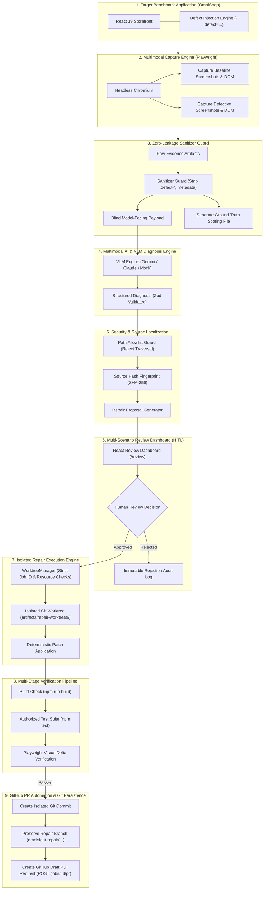

# OmniSight — Multimodal UI Self-Healing & Browser Automation RPA Agent

[](https://www.typescriptlang.org/)
[](https://react.dev/)
[](https://vitejs.dev/)
[](https://playwright.dev/)
[](https://fastapi.tiangolo.com/)
[](https://www.python.org/)
[](https://git-scm.com/)

> **Autonomous multimodal visual inspection, zero-leakage VLM defect diagnosis, human-in-the-loop repair governance, isolated Git worktree patch execution, and automated GitHub Pull Request workflows.**

---

## Table of Contents

1. [Project Overview & Vision](#1-project-overview--vision)
2. [Problem Statement & Real-World Motivation](#2-problem-statement--real-world-motivation)
3. [Core Objectives & Key Innovations](#3-core-objectives--key-innovations)
4. [End-to-End System Architecture](#4-end-to-end-system-architecture)
5. [Core Modules & Engine Breakdown](#5-core-modules--engine-breakdown)
   - [Module A: Benchmark Application & Defect Injection Engine (OmniShop)](#module-a-benchmark-application--defect-injection-engine-omnishop)
   - [Module B: Automated Multimodal Capture Engine (Playwright)](#module-b-automated-multimodal-capture-engine-playwright)
   - [Module C: Vision-Language Model (VLM) Diagnosis Engine](#module-c-vision-language-model-vlm-diagnosis-engine)
   - [Module D: Source-Path Security & Localization Engine](#module-d-source-path-security--localization-engine)
   - [Module E: Multi-Scenario Review Dashboard (React + TypeScript)](#module-e-multi-scenario-review-dashboard-react--typescript)
   - [Module F: Human-in-the-Loop (HITL) Proposal & Approval Governance Engine](#module-f-human-in-the-loop-hitl-proposal--approval-governance-engine)
   - [Module G: Deterministic Repair Execution Engine (Git Worktree Isolation)](#module-g-deterministic-repair-execution-engine-git-worktree-isolation)
   - [Module H: Post-Repair Visual & Automated Verification Engine](#module-h-post-repair-visual--automated-verification-engine)
   - [Module I: GitHub Pull Request Automation Service](#module-i-github-pull-request-automation-service)
   - [Module J: FastAPI Backend Service & Asynchronous Job Orchestration](#module-j-fastapi-backend-service--asynchronous-job-orchestration)
6. [Technology Stack & Technical Rationale](#6-technology-stack--technical-rationale)
7. [Defect Injection, Scenarios & Visual Evidence Pipeline](#7-defect-injection-scenarios--visual-evidence-pipeline)
8. [Human-in-the-Loop (HITL) Safety & Guardrails](#8-human-in-the-loop-hitl-safety--guardrails)
9. [Repository Structure & Multi-Branch Architecture](#9-repository-structure--multi-branch-architecture)
10. [Getting Started & Installation Guide](#10-getting-started--installation-guide)
11. [API Reference & Backend Repair Workflow](#11-api-reference--backend-repair-workflow)
12. [Testing, Evaluation & QA Strategy](#12-testing-evaluation--qa-strategy)
13. [Team Member Contributions & Division of Work](#13-team-member-contributions--division-of-work)
14. [Current Implementation Status & Roadmap](#14-current-implementation-status--roadmap)
15. [Known Limitations & Future Scope](#15-known-limitations--future-scope)
16. [Contributors & Acknowledgments](#16-contributors--acknowledgments)

---

## 1. Project Overview & Vision

Modern web applications are continuously evolving, frequently deployed, and rendered across dozens of viewports, browsers, and devices. In this fast-paced development cycle, **visual regressions, unexpected layout shifts, CSS breakages, and accessibility failures** represent some of the most pervasive yet elusive defects. Traditional test automation suites rely predominantly on DOM element presence or rigid snapshot baselines, frequently failing to identify visual regressions or suffering from extreme flakiness when selectors change.

**OmniSight** is an enterprise-grade **Multimodal UI Self-Healing and Robotic Process Automation (RPA) Platform**. By integrating automated headless browser instrumentation (Playwright), state-of-the-art Vision-Language Models (VLM), strict source code localization, robust human-in-the-loop approval workflows, and isolated Git worktree execution, OmniSight delivers a closed-loop platform that:

1. **Captures** high-resolution paired visual evidence and sanitized DOM structures.
2. **Diagnoses** visual anomalies blindly without ground-truth contamination.
3. **Localizes** the underlying stylesheet or component defect with cryptographic SHA-256 integrity verification.
4. **Presents** actionable, multi-scenario repair proposals to human engineers.
5. **Applies** deterministic patches inside ephemeral, isolated Git worktrees without touching the developer's working tree.
6. **Verifies** regressions across build compilation, automated test suites, and rendered visual metrics.
7. **Creates** verified GitHub Draft Pull Requests ready for review and automated merging.

OmniSight evolves the paradigm from **brittle, manual bug hunting** to **autonomous, audited, and resilient UI self-healing**.

---

## 2. Problem Statement & Real-World Motivation

Automated software testing has excelled at verifying business logic and API contracts, but visual quality assurance remains overwhelmingly manual and reactive. When UI regressions slip into production, they directly degrade user trust, harm brand credibility, impair accessibility compliance (WCAG 2.1), and depress conversion rates.

Key challenges addressed by OmniSight:
- **Blindness of DOM-Only Testing**: A DOM element can be technically mounted in the DOM tree, pass traditional assertions (`toBeVisible()`), and yet be completely obscured, distorted (`object-fit: fill`), shifted off-screen, or unreadable due to inadequate contrast.
- **Selector Fragility**: End-to-end test suites break frequently when designers or developers update class names, layout structures, or design tokens.
- **Risks of Autonomous Code Modification**: Directly allowing an AI agent to write modifications to a primary codebase or production repository is dangerous. AI hallucinations can introduce syntax errors, security vulnerabilities, or unintended regressions.
- **Ground-Truth Contamination in AI Benchmarking**: Evaluating multimodal AI models requires clean, unbiased inputs. If model prompts contain leakages of the expected defect or internal testing markers, evaluation metrics become invalid.

OmniSight addresses these challenges with an architecture rooted in **strict isolation, cryptographic source freshness, zero-leakage evaluation pipelines, and mandatory human governance**.

---

## 3. Core Objectives & Key Innovations

| Objective | Innovation in OmniSight |
|---|---|
| **Controlled Defect Benchmark** | Built-in e-commerce storefront (**OmniShop**) featuring deterministically injected, isolated, and reversible visual defects via query parameters without code mutation. |
| **Zero-Leakage Multimodal VLM Inspection** | Automated sanitization stripping all defect markers, identifiers, and class tokens from captured HTML and payloads before model evaluation. |
| **Cryptographic Source Freshness** | SHA-256 fingerprinting of targeted stylesheets and source components ensuring proposals are never applied against stale or concurrently modified files. |
| **Multi-Scenario Architecture (V2)** | Transitioned from monolithic "one capture → one repair" to "one capture → multiple independent scenarios → independent approvals → independent repairs". |
| **Human-in-the-Loop (HITL) Safety Gate** | Mandatory engineer approval with immutable audit logs before any repair patch can be executed. |
| **Git Worktree Sandbox Isolation** | Patches are applied exclusively inside temporary Git worktrees (`git worktree add -b omnisight-repair/<job-id>`), completely shielding the main working tree from contamination. |
| **Multi-Stage Automated Verification** | Automatic execution of compilation builds, authorized test suites, and rendered visual delta metrics (contrast ratios, bounding boxes, overflow) before certifying a repair. |
| **Automated GitHub Draft PR Pipeline** | Automatic generation of traceable Git commits, preserved repair branches, and authenticated GitHub Draft Pull Requests containing comprehensive verification metadata. |

---

## 4. End-to-End System Architecture

The following diagram illustrates the complete end-to-end data flow and lifecycle of an OmniSight repair job:



---

## 5. Core Modules & Engine Breakdown

### Module A: Benchmark Application & Defect Injection Engine (OmniShop)
* **Directory**: `src/`, `src/components/`, `src/pages/`, `src/data/`, `src/context/`
* **Lead Engineer**: Ajay Kowkuntla
* **Status**: Implemented & Verified
* **Functionality**:
  * Complete, functional e-commerce storefront with catalog browsing, dynamic routing (`/products/:id`), shopping cart state persistence (`CartContext`), and checkout workflows.
  * Controlled Defect-Injection Framework (`src/context/DefectContext.tsx`) allowing deterministic activation of 4 distinct visual bug scenarios via URL query parameters (`?defect=<category>`).
  * Strict isolation: defect injection is disabled by default in production builds, isolated to scoped styling classes, fails safely on unknown IDs, and does not corrupt application business logic or state.

### Module B: Automated Multimodal Capture Engine (Playwright)
* **Directory**: `scripts/capture-visual-evidence.ts`, `tests/evidence-harness.spec.ts`
* **Lead Engineer**: Ajay Kowkuntla
* **Status**: Implemented & Verified
* **Functionality**:
  * Headless Chromium automation executing paired visual captures (clean baseline vs. defective state) across responsive viewports (`1440x900` desktop, `390x844` mobile).
  * Captures full-page screenshots, sanitized DOM trees, console error logs, network requests, and precise rendered layout measurements (bounding boxes, computed styles, color luminance).

### Module C: Vision-Language Model (VLM) Diagnosis Engine
* **Directory**: `scripts/vlm/`, `scripts/run-diagnosis.ts`, `scripts/evaluate-diagnoses.ts`
* **Lead Engineer**: Yuvraj
* **Status**: Implemented (Provider abstractions active; prompt/leakage token alignment under active refinement)
* **Functionality**:
  * Multi-provider visual inspection harness supporting Google Gemini Multimodal APIs, Anthropic Claude 3.5 Sonnet, OpenAI GPT-4o, and an offline deterministic Mock provider.
  * Strict prompt engineering enforcing zero ground-truth leakage, structured JSON diagnosis output, confidence interval bounding `[0.0, 1.0]`, defect categorization, and visual bounding box predictions.
  * Automated diagnosis evaluation scoring model accuracy against independent ground-truth evaluation manifests without model bias.

### Module D: Source-Path Security & Localization Engine
* **Directory**: `scripts/vlm/source-path-security.ts`, `scripts/vlm/source-localization-service.ts`
* **Lead Engineer**: Ajay Kowkuntla
* **Status**: Implemented & Verified
* **Functionality**:
  * Strict filesystem security guard enforcing `SOURCE_FILE_ALLOWLIST` (allowing only approved frontend stylesheets and components).
  * Path traversal protection immediately rejecting `..`, absolute paths (`/etc/passwd`), configuration files, hidden dotfiles, and build outputs.
  * Cryptographic source fingerprinting generating 64-character SHA-256 hashes of target files and extracting bounded code snippets with surrounding line context.

### Module E: Multi-Scenario Review Dashboard (React + TypeScript)
* **Directory**: `src/pages/ReviewDashboard.tsx`, `src/components/review/`
* **Lead Engineers**: Sahil & Ajay Kowkuntla
* **Status**: Implemented & Verified (Single-proposal flow active; multi-scenario UI foundation integrated)
* **Functionality**:
  * Interactive engineering dashboard supporting the OmniSight Multi-Scenario workflow.
  * Allows reviewers to inspect multiple detected defect scenarios under a capture job.
  * Interactive side-by-side visual diff comparisons, VLM diagnosis rationales, affected selectors, source code excerpts, and independent scenario approval/rejection actions.

### Module F: Human-in-the-Loop (HITL) Proposal & Approval Governance Engine
* **Directory**: `src/services/reviewRepository.ts`, `scripts/vlm/repair-proposal-service.ts`
* **Lead Engineers**: Sahil & Ajay Kowkuntla
* **Status**: Implemented & Verified
* **Functionality**:
  * Critical safety invariant: **proposals NEVER modify source files directly**.
  * Enforces mandatory developer sign-off (`humanReviewStatus: "approved"`).
  * Supports approval, rejection with mandatory developer feedback rationale, and immutable local and backend audit logging.
  * Rejects execution if the current file hash on disk differs from the proposal's recorded hash (preventing stale patch application).

### Module G: Deterministic Repair Execution Engine (Git Worktree Isolation)
* **Directory**: `scripts/repair/`, `scripts/repair/worktree-manager.ts`, `scripts/repair/repair-execution-service.ts`
* **Lead Engineer**: Ajay Kowkuntla
* **Status**: Implemented & Verified (33 regression tests passing)
* **Functionality**:
  * Ephemeral Git worktree management creating isolated sandboxes under `artifacts/repair-worktrees/<job-id>` with dedicated branches `omnisight-repair/<job-id>`.
  * Strict job ID validation (`^[a-zA-Z0-9][a-zA-Z0-9_-]{0,127}$`) and pre-flight collision checks preventing duplicate branch or directory overwrite.
  * Safe deterministic patch application (`scripts/repair/patch-registry.ts`) executing only pre-verified fixes against allowlisted files.
  * Zero main working tree modification guarantee.

### Module H: Post-Repair Visual & Automated Verification Engine
* **Directory**: `scripts/repair/repair-execution-service.ts`, `tests/repair-execution.spec.ts`
* **Lead Engineer**: Ajay Kowkuntla
* **Status**: Implemented & Verified
* **Functionality**:
  * Automated TypeScript compilation check (`tsc -b && vite build`) inside the isolated worktree.
  * Automated execution of authorized test patterns (`npm test -- ...`) with process timeouts and command injection prevention.
  * Automated Playwright post-repair visual verification asserting quantitative metrics: aspect ratios restored to `1.0`, contrast ratios exceeding WCAG AA `4.5:1`, bounding box overlaps cleared, and horizontal overflow eliminated (`scrollWidth <= clientWidth`).

### Module I: GitHub Pull Request Automation Service
* **Directory**: Backend integration branch `integration/backend-repair-e2e` (`backend/github_client.py`, `backend/api.py`)
* **Lead Engineers**: Shilpa & Ajay Kowkuntla
* **Status**: Implemented & Verified on backend integration branch
* **Functionality**:
  * GitHub API integration generating tracked Git commits with structured author metadata and pushing branches to remote repositories.
  * Automated GitHub Draft Pull Request creation (`POST /jobs/{job_id}/pr`) linking repair execution reports, before/after visual evidence, test results, and reviewer notes.
  * Pull request status retrieval endpoint (`GET /jobs/{job_id}/pr`).

### Module J: FastAPI Backend Service & Asynchronous Job Orchestration
* **Directory**: Backend integration branch `integration/backend-repair-e2e` (`backend/api.py`, `backend/job_store.py`)
* **Lead Engineer**: Shilpa
* **Status**: Single-proposal API deployed & tested (120+ tests); Multi-scenario V2 contract drafted & client-integrated
* **Functionality**:
  * High-performance asynchronous backend powering job creation, scenario management, repair job triggering, and PR workflows.
  * Complete implementation of single-proposal backend endpoints and authoritative specification of Backend Contract V2 (`CONTRACT_V2_DRAFT.md`).
  * Comprehensive automated test suite comprising 120+ unit and integration tests.

---

## 6. Technology Stack & Technical Rationale

| Layer | Technologies Selected | Technical Rationale |
|---|---|---|
| **Target Application** | **React 19.2, TypeScript ~6.0, Vite 8.3, CSS3** | High-performance modern UI stack; fast Hot Module Replacement (HMR); strict type safety; native CSS tokenization enabling isolated defect injection. |
| **Browser Automation** | **Playwright 1.64 (`@playwright/test`)** | Native multi-browser automation; deterministic headless execution; pixel-perfect screenshots; rich DOM and console instrumentation; mobile viewport emulation. |
| **AI & Multimodal Vision** | **Google Gemini Multimodal APIs, Claude 3.5 Sonnet, Mock VLM** | Multimodal image understanding capable of spatial reasoning, layout analysis, and zero-shot defect classification. Offline Mock provider ensures fast, cost-free CI/CD testing. |
| **Backend & Orchestration** | **Python 3.11+, FastAPI (>=0.110), Pydantic (>=2.6), Uvicorn (>=0.29)** | Asynchronous I/O performance; automatic OpenAPI documentation; robust Pydantic data validation; clean decoupling from frontend clients. |
| **Sandboxing & VCS** | **Git Worktrees, child_process (`execFile`)** | Complete isolation: patches and builds run in isolated filesystem directories without polluting developer work trees or triggering hot-reloading loops. Safe argument arrays prevent shell injection. |
| **API Client & State** | **TypeScript, Fetch API, LocalStorage Adapter** | Resilient client architecture supporting fallback to local demo persistence or full connection to remote FastAPI microservices. |

---

## 7. Defect Injection, Scenarios & Visual Evidence Pipeline

OmniSight evaluates its detection and repair engines against four standardized, high-impact UI defect categories:

```
┌────────────────────────────────────────────────────────────────────────────┐
│                    OMNISIGHT BENCHMARK DEFECT SCENARIOS                    │
├────────────────────────────┬─────────────────────────────┬─────────────────┤
│ Scenario Identifier        │ Category                    │ Route & Target  │
├────────────────────────────┼─────────────────────────────┼─────────────────┤
│ product-image-distortion   │ Visual Aspect Ratio Flaw    │ /products (Card)│
│ product-card-layout-break  │ Layout & Structure Shift    │ /products (Card)│
│ low-contrast-text          │ Accessibility (WCAG 2.1)    │ /products (Card)│
│ mobile-nav-overflow        │ Responsive Horizontal Break │ / (Navbar)      │
└────────────────────────────┴─────────────────────────────┴─────────────────┘
```

### Detailed Scenario Specifications

#### 1. Product Image Distortion (`product-image-distortion`)
* **Trigger URL**: `/products?defect=product-image-distortion`
* **Affected Component**: `ProductCard.tsx` / `src/index.css`
* **Visual Symptom**: Product catalog images lose their native square aspect ratio due to `object-fit: fill` and forced vertical stretching to `height: 380px`.
* **Quantitative Measurements**:
  * Rendered container height: `265px` (clean) vs. `380px` (defective).
  * `object-fit`: `cover` (clean) vs. `fill` (defective).
* **Repair Assertion**: Container height restored to `265px` and `object-fit` set to `cover`.

#### 2. Product Card Layout Breakage (`product-card-layout-break`)
* **Trigger URL**: `/products?defect=product-card-layout-break`
* **Affected Component**: `ProductCard.tsx` / `src/index.css`
* **Visual Symptom**: Card body overlaps image container; action footer button is positioned absolute with negative bottom displacement, protruding outside the card container.
* **Quantitative Measurements**:
  * Footer position: `static` (clean) vs. `absolute` with `bottom: -45px` (defective).
  * Bounding box overlap: `0px` (clean) vs. `28px` protrusion below card container (defective).
* **Repair Assertion**: Footer positioned statically inside the card boundaries with zero protrusion.

#### 3. Low-Contrast Text / Accessibility Defect (`low-contrast-text`)
* **Trigger URL**: `/products?defect=low-contrast-text`
* **Affected Component**: `ProductCard.tsx` / `src/index.css`
* **Visual Symptom**: Product titles, descriptions, and price typography render in light grey (`#cbd5e1`) against a white card background (`#ffffff`), severely violating WCAG 2.1 AA accessibility contrast rules.
* **Quantitative Measurements**:
  * Foreground color: `#1e293b` (clean) vs. `#cbd5e1` (defective).
  * Calculated contrast ratio: `4.76:1` (clean, passes AA) vs. `1.48:1` (defective, fails AA).
* **Repair Assertion**: Computed contrast ratio exceeds `4.5:1` against the card background.

#### 4. Mobile Navigation Overflow (`mobile-nav-overflow`)
* **Trigger URL**: `/products?defect=mobile-nav-overflow` (Viewport: `390px × 844px`)
* **Affected Component**: `Navbar.tsx` / `src/index.css`
* **Visual Symptom**: Desktop navigation menu container forces a fixed width of `650px` on mobile viewports, introducing severe horizontal page scrolling and breaking viewport responsiveness.
* **Quantitative Measurements**:
  * Viewport width: `390px`.
  * Document `scrollWidth`: `390px` (clean) vs. `650px` (defective).
  * Horizontal overflow delta: `0px` (clean) vs. `260px` unintended scroll width (defective).
* **Repair Assertion**: Document `scrollWidth <= clientWidth` (`390px`) on mobile viewport.

### Visual Evidence Directory Structure

Each capture run generates an isolated, timestamped bundle under `artifacts/visual-evidence/<run-id>/`:

```text
artifacts/visual-evidence/<run-id>/
├── manifest.json                     # Overall run summary, scenarios index, and status
├── model_facing_evidence.json        # Zero-leakage payload provided to VLM (NO ground-truth labels)
├── ground_truth_eval.json            # Authoritative benchmark scoring file
└── <scenario-id>/
    ├── baseline.png                  # Clean reference screenshot
    ├── defective.png                 # Defective visual screenshot
    ├── dom-baseline.html             # Clean sanitized DOM snapshot
    ├── dom-defective.html            # Defective sanitized DOM snapshot
    ├── measurements-baseline.json    # Quantitative bounding boxes and styles (clean)
    ├── measurements-defective.json   # Quantitative bounding boxes and styles (defective)
    └── measurements.json             # Computed deltas
```

---

## 8. Human-in-the-Loop (HITL) Safety & Guardrails

To prevent unintended modifications and ensure trust, OmniSight enforces strict architectural safety guardrails:

```
                                  [AI Repair Proposal]
                                           │
                                           ▼
                       ┌───────────────────────────────────────┐
                       │      Source Path Allowlist Guard      │
                       │    (Reject traversal, configs, .env)  │
                       └───────────────────┬───────────────────┘
                                           │ Passes
                                           ▼
                       ┌───────────────────────────────────────┐
                       │     Cryptographic Freshness Check     │
                       │  (Verify SHA-256 vs. current on-disk) │
                       └───────────────────┬───────────────────┘
                                           │ Matches
                                           ▼
                       ┌───────────────────────────────────────┐
                       │       Human Review Authorization      │
                       │    (Explicit reviewer confirmation)   │
                       └───────────────────┬───────────────────┘
                                           │ Approved
                                           ▼
                       ┌───────────────────────────────────────┐
                       │     Isolated Git Worktree Sandbox     │
                       │  (Zero modification to working tree)  │
                       └───────────────────────────────────────┘
```

1. **Non-Destructive Proposal Invariant**: Generating repair proposals never modifies application code. Proposals are treated as immutable review artifacts.
2. **Mandatory Human Sign-Off**: The repair execution service strictly requires `proposal.humanReviewStatus === "approved"`. Any repair job initiated with `pending_review` or `rejected` is rejected with zero code modifications.
3. **Cryptographic Source Freshness**: Proposals record a SHA-256 hash of the target source file at inspection time. If the file has changed on disk, the proposal is flagged as `stale_source` and execution is aborted.
4. **Strict Path Allowlist (`SOURCE_FILE_ALLOWLIST`)**: Only designated styling and component paths (`src/index.css`, `src/components/*.tsx`, `src/pages/*.tsx`) can be targeted. Path traversal (`../`), root paths, and sensitive files (`.env`, `package.json`, `.git/`) are blocked.
5. **Safe Git Process Execution**: All Git operations execute via `execFile` with explicit argument arrays, preventing shell injection vulnerabilities.
6. **Worktree Isolation**: Code modifications, patch applications, and build tests take place inside ephemeral worktree folders under `artifacts/repair-worktrees/<job-id>`. The developer's active working tree remains untouched.
7. **Worktree Manager Collision Protection**: Job IDs must adhere to `/^[a-zA-Z0-9][a-zA-Z0-9_-]{0,127}$/`. If a branch, worktree directory, or registered worktree already exists, the engine aborts rather than deleting or overwriting pre-existing work.

---

## 9. Repository Structure & Multi-Branch Architecture

The OmniSight codebase is organized modularly across specialized Git branches:

* **`feature/ajay-defect-injection`** (Current Branch): Core benchmark storefront (`OmniShop`), controlled defect framework, Playwright capture pipeline, deterministic repair execution engine, WorktreeManager safety guards, V2 API client, and evaluation bundles.
* **`integration/backend-repair-e2e`** (Backend Integration Branch): FastAPI server (`api.py`), SQLite job store, repair runner, GitHub PR integration service, and backend test suites (mirrored locally under `artifacts/integration-backend/`).
* **`feature/yuvaraj-ai-engine`**: Vision-Language Model diagnosis engine, prompt engineering, and evaluation scoring.
* **`feature/sahil-review-ui`**: Review dashboard UI components and review history interfaces.

### File Map (`feature/ajay-defect-injection`)

```text
OmniSight/
├── artifacts/
│   ├── diagnoses/                     # Structured VLM diagnosis JSON outputs
│   ├── integration-backend/           # Local worktree for backend integration branch
│   ├── repair-executions/             # Machine-readable repair execution reports
│   ├── repair-proposals/              # Human-review proposal artifacts & diffs
│   ├── repair-worktrees/              # Ephemeral Git worktree sandboxes (git-ignored)
│   └── visual-evidence/               # Captured screenshot and DOM bundles
├── omnisight-yuvraj-evaluation/       # Zero-leakage evaluation dataset bundle
├── public/                            # Static assets and benchmark images
├── scripts/
│   ├── capture-visual-evidence.ts     # Automated visual evidence capture harness
│   ├── run-diagnosis.ts               # VLM diagnosis pipeline CLI runner
│   ├── evaluate-diagnoses.ts          # Benchmark diagnosis evaluation scoring
│   ├── generate-repair-proposals.ts   # Source localization & proposal generator
│   ├── run-repair-job.ts              # Deterministic repair execution CLI runner
│   ├── repair/                        # Repair Execution Engine core modules
│   │   ├── worktree-manager.ts        # Git worktree lifecycle & safety manager
│   │   ├── patch-registry.ts          # Deterministic registered patches
│   │   ├── repair-execution-service.ts# End-to-end repair orchestration
│   │   └── repair-job-schema.ts       # Repair contract types and validation
│   └── vlm/                           # VLM diagnosis & security utilities
│       ├── source-path-security.ts    # Allowlist & SHA-256 hash validation
│       ├── source-localization-service.ts # Component & CSS excerpt locator
│       └── repair-proposal-service.ts # Bounded diff generation
├── src/                               # Frontend Application & Benchmark Storefront
│   ├── components/                    # Reusable UI components (Navbar, ProductCard)
│   │   └── review/                    # HITL Review Dashboard components
│   ├── context/                       # React Context (CartContext, DefectContext)
│   ├── data/                          # Mock product catalog & defect definitions
│   ├── pages/                         # Storefront pages & ReviewDashboard
│   ├── services/                      # API clients (backendRepairClient, reviewRepository)
│   ├── App.tsx                        # Main client routing
│   ├── main.tsx                       # React application entrypoint
│   └── index.css                      # Design tokens, typography & defect styles
├── tests/                             # Playwright automated test suite (190+ tests)
│   ├── repair-execution.spec.ts       # Worktree isolation & repair validation tests
│   ├── review-dashboard.spec.ts       # HITL Dashboard user interaction tests
│   ├── defect-injection.spec.ts       # Defect injection framework verification
│   ├── vlm-diagnosis.spec.ts          # VLM diagnosis & zero-leakage tests
│   ├── backend-repair-client.spec.ts  # Multi-Scenario V2 API client tests
│   └── shopping-cart.spec.ts          # Storefront business logic tests
├── package.json                       # Node dependencies & npm scripts
├── playwright.config.ts               # Playwright test configuration
├── tsconfig.json                      # Strict TypeScript compiler options
└── vite.config.ts                     # Vite build & proxy configuration
```

---

## 10. Getting Started & Installation Guide

### Prerequisites
- **Node.js**: v18.0.0 or later (v20+ LTS recommended)
- **npm**: v9.0.0 or later
- **Python**: v3.11 or later
- **Git**: v2.30+ (supporting `git worktree`)

### 1. Clone the Repository
```bash
git clone https://github.com/Veggies02/OmniSight.git
cd OmniSight
git checkout feature/ajay-defect-injection
```

### 2. Frontend & Tooling Setup
```bash
# Install frontend and scripting dependencies
npm install

# Install Playwright browser binaries
npx playwright install chromium
```

### 3. Backend Setup (Optional for Full Microservice Mode)
```bash
# Backend code resides on the integration/backend-repair-e2e branch
# (or in artifacts/integration-backend/backend/ if using worktree)
cd artifacts/integration-backend/backend
python -m venv .venv
source .venv/bin/activate  # On Windows: .venv\Scripts\activate
pip install -r requirements.txt
cd ../../..
```

### 4. Environment Configuration
Create a `.env` file in the root directory if integrating with live AI providers or GitHub:
```env
# Multimodal VLM Provider API Keys (optional; defaults to offline Mock provider)
GEMINI_API_KEY=your_gemini_api_key_here
ANTHROPIC_API_KEY=your_anthropic_api_key_here
OPENAI_API_KEY=your_openai_api_key_here

# GitHub Integration (for automated PR creation on backend)
GITHUB_TOKEN=your_github_personal_access_token
OMNISIGHT_GITHUB_REPO=Veggies02/OmniSight

# Application Flags
VITE_ENABLE_DEFECTS=true
```

### 5. Running the Application
```bash
# Start the Vite development server (Storefront + Review Dashboard)
npm run dev
# -> Accessible at http://localhost:5173/

# In a separate terminal, start the FastAPI backend (if running full stack)
cd artifacts/integration-backend/backend
uvicorn api:app --reload --port 8000
# -> API Docs accessible at http://localhost:8000/docs
```

### 6. Executing Pipeline Operations via CLI

```bash
# 1. Capture visual evidence across all defect scenarios
npm run capture:evidence

# 2. Run blind VLM defect diagnosis (using Mock or Gemini provider)
npm run diagnose:evidence -- --provider=mock

# 3. Evaluate diagnosis accuracy against ground truth
npm run evaluate:diagnoses

# 4. Generate bounded repair proposals with SHA-256 freshness hashes
npm run repair:proposals

# 5. Execute an approved repair job inside an isolated Git worktree
npm run repair:execute -- --job-id=job-demo-01 --proposal=artifacts/repair-proposals/latest/prop-001.json
```

---

## 11. API Reference & Backend Repair Workflow

### 1. Currently Deployed Backend Endpoints (Single-Proposal Flow)
*Implemented and tested on `integration/backend-repair-e2e` in `backend/api.py`:*

| Method | Endpoint | Description |
|---|---|---|
| `GET` | `/health` | Health check endpoint returning backend status. |
| `POST` | `/jobs` | Creates a new capture and inspection job for a target application URL. |
| `GET` | `/jobs` | Lists all existing jobs with status and summaries. |
| `GET` | `/jobs/{job_id}` | Retrieves job details, status, and attached proposal/repair records. |
| `GET` | `/jobs/{job_id}/artifacts` | Lists artifacts (screenshots, reports) generated for the job. |
| `POST` | `/jobs/{job_id}/proposal` | Attaches a generated repair proposal to the job. |
| `POST` | `/jobs/{job_id}/approval` | Records human review decision (`approved` or `rejected`). |
| `POST` | `/jobs/{job_id}/repair` | Triggers repair execution in an isolated Git worktree (Status: 202 Accepted). |
| `POST` | `/jobs/{job_id}/pr` | Creates a GitHub Draft Pull Request for a verified repair job. |
| `GET` | `/jobs/{job_id}/pr` | Retrieves Pull Request URL and metadata for a repair job. |
| `POST` | `/webhooks/ci` | Ingestion webhook for CI/CD status updates. |

### 2. Multi-Scenario Backend Contract V2 (Draft & Frontend Client Integrated)
*Specified in `CONTRACT_V2_DRAFT.md`; client implemented in `src/services/backendRepairClient.ts`:*

| Method | Endpoint | Description | Status |
|---|---|---|---|
| `GET` | `/jobs/{id}/scenarios` | Lists all detected defect scenarios under a capture job. | Frontend Client Ready |
| `GET` | `/jobs/{id}/scenarios/{scenario_id}` | Retrieves scenario details, VLM diagnosis, and proposal. | Frontend Client Ready |
| `POST` | `/jobs/{id}/scenarios/{scenario_id}/approval` | Approves a specific scenario proposal (`X-Operator-Token`). | Frontend Client Ready |
| `POST` | `/jobs/{id}/scenarios/{scenario_id}/rejection` | Rejects a specific scenario proposal with reason. | Frontend Client Ready |
| `POST` | `/jobs/{id}/scenarios/{scenario_id}/repair` | Triggers isolated worktree repair for this scenario. | Frontend Client Ready |
| `POST` | `/jobs/{id}/scenarios/{scenario_id}/pr` | Creates a Draft PR for an independently repaired scenario. | Frontend Client Ready |
| `GET` | `/jobs/{id}/scenarios/{scenario_id}/pr` | Retrieves PR metadata for a specific scenario. | Frontend Client Ready |

### Repair Execution State Machine
*As implemented in `scripts/repair/repair-job-schema.ts` and `scripts/repair/repair-execution-service.ts`:*

```
PENDING
  │
  ├────────────────────────────────────────(Rejected/Stale)───────────┐
  │                                                                   │
  ▼                                                                   ▼
VALIDATING_APPROVAL ──(Approval Failed / Hash Stale)───────────────> REJECTED [Terminal]
  │
  ▼ (Approval Verified & Source Fresh)
PREPARING_WORKTREE ───(Job ID Invalid / Branch or Directory Exists)─> FAILED [Terminal]
  │
  ▼ (Worktree Created in artifacts/repair-worktrees/<job-id>)
PATCH_APPLIED ────────(File Write / Line Normalization Error)───────> FAILED [Terminal]
  │
  ▼ (Deterministic Patch Applied from patch-registry.ts)
RUNNING_TESTS ────────(Build Failure / Required Test Failure)───────> FAILED [Terminal]
  │
  ▼ (npm run build & authorized tests passed)
VISUAL_VALIDATION ────(Aspect Ratio / Contrast / Overflow Failure)──> FAILED [Terminal]
  │
  ▼ (All Visual Delta Assertions Passed)
CLEANUP_REQUIRED ─────(Commit Changes & Preserve Branch)────────────> PASSED [Terminal]
```

*Terminal States*:
- **`PASSED`**: Repair patch applied, compilation verified, authorized tests passed, visual deltas validated, commit created, and branch `omnisight-repair/<job-id>` preserved for PR creation.
- **`FAILED`**: Build, test, or visual validation failed; worktree and temporary branch safely deleted.
- **`REJECTED`**: Proposal lacked human approval or target source file was modified concurrently (`stale_source`).
- **`UNSUPPORTED`**: Defect scenario has no pre-registered safe patch; execution rejected safely without code modifications.

---

## 12. Testing, Evaluation & QA Strategy

OmniSight maintains a multi-layered automated test strategy spanning Playwright end-to-end tests, unit test suites, and regression guards:

```
┌─────────────────────────────────────────────────────────────────────────────┐
│                           OMNISIGHT QA TEST SUITES                          │
├──────────────────────────────┬───────────────┬──────────────────────────────┤
│ Test Suite                   │ Framework     │ Focus Area                   │
├──────────────────────────────┼───────────────┼──────────────────────────────┤
│ tests/repair-execution.spec  │ Playwright    │ Worktree isolation, patch    │
│                              │               │ application, build/visual    │
│                              │               │ verification, safety guards  │
│ tests/review-dashboard.spec  │ Playwright    │ HITL dashboard UI, approval/ │
│                              │               │ rejection flows, persistence │
│ tests/vlm-diagnosis.spec     │ Playwright    │ VLM diagnosis, schema typing,│
│                              │               │ zero-leakage sanitizer       │
│ tests/defect-injection.spec  │ Playwright    │ Defect injection reversibility│
│                              │               │ and styling isolation        │
│ tests/evidence-harness.spec  │ Playwright    │ Contrast calculations and    │
│                              │               │ screenshot capture accuracy  │
│ tests/backend-repair-client  │ Playwright    │ Multi-scenario V2 API client │
│ backend/tests/               │ Pytest        │ FastAPI routers, PR service, │
│                              │               │ asynchronous job workers     │
└──────────────────────────────┴───────────────┴──────────────────────────────┘
```

### Running Automated Tests

```bash
# Run all Playwright test suites
npm run test:e2e

# Run isolated repair execution tests specifically (including Worktree safety tests)
npx playwright test tests/repair-execution.spec.ts

# Run Multi-Scenario V2 API client tests
npx playwright test tests/backend-repair-client.spec.ts

# Run defect injection framework tests
npx playwright test tests/defect-injection.spec.ts
```

---

## 13. Team Member Contributions & Division of Work

The OmniSight platform is engineered collaboratively with clear division of responsibility across four core domains:

### 1. Ajay Kowkuntla — Benchmark Storefront, Defect Framework, Repair Engine & Automation
* **Assigned Branch**: `feature/ajay-defect-injection`
* **Key Contributions**:
  * **OmniShop E-Commerce Storefront**: Built the complete React 19 + TypeScript mock e-commerce testbed with routing, product catalog, dynamic details, cart state persistence, and responsive checkout.
  * **Defect Injection Framework**: Engineered the URL query-parameter defect injection system (`?defect=...`) with strict production guards and safe fallbacks.
  * **Visual Capture Harness**: Implemented the headless Playwright capture pipeline generating paired clean vs. defective screenshots and DOM snapshots.
  * **Deterministic Repair Execution Engine**: Architected the isolated Git worktree execution pipeline (`WorktreeManager`, `RepairExecutionService`, `patch-registry.ts`) that applies deterministic patches without modifying the main tree.
  * **Worktree Safety & Validation Architecture**: Implemented strict job ID validation (`^[a-zA-Z0-9][a-zA-Z0-9_-]{0,127}$`), pre-flight branch/directory collision checks, and regression test suites.
  * **Evaluation Dataset & Bundling**: Prepared and isolated the ground-truth evaluation bundles for Yuvraj's AI/VLM pipeline with complete leak prevention.
  * **Frontend Multi-Scenario Client**: Extended the frontend API client (`backendRepairClient.ts`) to support the Multi-Scenario V2 backend contract.

### 2. Yuvraj — Multimodal AI & Vision-Language Model (VLM) Diagnosis
* **Assigned Branch**: `feature/yuvaraj-ai-engine`
* **Key Contributions**:
  * **VLM Diagnosis Engine**: Developed the multimodal AI inspection engine integrating Google Gemini, Anthropic Claude, and OpenAI APIs.
  * **Prompt Engineering & Structured Outputs**: Formulated zero-leakage blind inspection prompts and enforced strict Zod schema validation for diagnosis JSON outputs.
  * **Defect Categorization & Visual Localization**: Engineered bounding box extraction and root cause reasoning comparing baseline and defective renders.
  * **Benchmark Evaluation**: Designed quantitative scoring algorithms comparing model diagnoses against ground-truth evaluation manifests.

### 3. Shilpa — Backend Architecture, Job Orchestration & GitHub Integration
* **Assigned Branch**: `integration/backend-repair-e2e`
* **Key Contributions**:
  * **FastAPI Backend Architecture**: Designed and deployed the asynchronous FastAPI service powering job management, scenario listing, and repair orchestration.
  * **Backend Contract V2 Design**: Authored the authoritative multi-scenario specification (`CONTRACT_V2_DRAFT.md`) enabling independent scenario lifecycles.
  * **GitHub PR Service**: Built the server-side GitHub integration (`github_client.py`) automating Draft Pull Request creation with commit and verification metadata.
  * **Backend Test Suite**: Developed and maintained the 120+ test suite ensuring robustness across all API routers and background workers.

### 4. Sahil — Human-in-the-Loop Review Dashboard & UI/UX
* **Assigned Branch**: `feature/sahil-review-ui`
* **Key Contributions**:
  * **HITL Review Console**: Designed and implemented the web-based review console (`/review`) for inspecting AI-generated repair proposals.
  * **Side-by-Side Visual Comparator**: Built the interactive image comparison component displaying before-and-after visual evidence.
  * **Reviewer Action Workflows**: Implemented approval and rejection modals with required feedback inputs and state transition badges.
  * **Audit Log & History**: Created the review history inspector tracking human decisions and feedback rationales.

---

## 14. Current Implementation Status & Roadmap

| Feature / Capability | Implementation Status | Test Coverage | Technical Details |
|---|---|---|---|
| **OmniShop E-Commerce Benchmark** | **Implemented** | Tested (`tests/shopping-cart.spec.ts`) | React 19 storefront with catalog, cart persistence, dynamic routes, and checkout. |
| **Defect Injection Engine** | **Implemented** | Tested (`tests/defect-injection.spec.ts`) | 4 seeded defect scenarios activated via query params with production guards. |
| **Multimodal Capture Harness** | **Implemented** | Tested (`tests/evidence-harness.spec.ts`) | Playwright paired capture producing clean/defective screenshots, DOM, and metrics. |
| **Zero-Leakage Sanitizer** | **Implemented** | Tested (`tests/evaluation-dataset.spec.ts`) | Strips defect tokens and attributes from model-facing payloads and dataset bundles. |
| **Git Worktree Isolation** | **Implemented** | Tested (`tests/repair-execution.spec.ts`) | Ephemeral worktrees with strict Job ID validation and collision protection. |
| **Deterministic Patch Registry** | **Implemented** | Tested (`tests/repair-execution.spec.ts`) | Safe, bounded patches applied only to allowlisted source files. |
| **Multi-Stage Verification** | **Implemented** | Tested (`tests/repair-execution.spec.ts`) | Automated compilation (`tsc && vite build`), test suites, and visual delta assertions. |
| **Multi-Scenario Frontend Client** | **Implemented** | Tested (`tests/backend-repair-client.spec.ts`) | Full V2 client supporting scenario approvals, rejections, repairs, and PR tracking. |
| **Single-Proposal FastAPI Backend** | **Implemented** | Tested (`backend/tests/`) | Live on `integration/backend-repair-e2e`; powers jobs, proposals, and PR creation. |
| **GitHub Draft PR Integration** | **Implemented** | Tested (`backend/tests/`) | Server-side Git branch push and GitHub Draft PR creation via REST API. |
| **Multi-Scenario Backend V2** | *Partially Integrated* | Contract Specified | `CONTRACT_V2_DRAFT.md` drafted; frontend client ready; backend server integration in progress. |
| **VLM Prompt/Sanitizer Alignment** | *Under Refinement* | Diagnosed | Evaluation dataset token list requires prompt separation in diagnosis service. |
| **Autonomous LLM Patch Synthesis** | *Planned (Phase 3)* | Unimplemented | Generative patch synthesis replacing deterministic registered patches. |
| **Automated PR Merging & Canary** | *Planned (Phase 3)* | Unimplemented | Automated PR merging upon passing CI checks with canary visual monitoring. |

---

## 15. Known Limitations & Future Scope

### Known Limitations
1. **Deterministic Registered Patches**: Current repair execution utilizes verified, pre-registered patches (`REGISTERED_PATCHES`) for the benchmark defects. While this guarantees absolute safety, arbitrary novel defects require human patch intervention or LLM patch synthesis.
2. **Local Worktree Sandboxing**: Worktree isolation relies on local Git repositories and filesystem write permissions. In containerized microservices, worktrees require ephemeral storage volumes with Git installed.
3. **Single-Page Inspection Scope**: Current capture targets individual page routes rather than recursive multi-page crawls.

### Future Scope
- **Autonomous Generative Patch Synthesis**: Incorporate bounded Large Language Models with AST (Abstract Syntax Tree) linting to synthesize novel CSS and React patches for previously unseen visual defects.
- **Continuous Visual Regression Monitoring (Canary)**: Deploy OmniSight as a continuous monitoring daemon in staging and production pipelines to flag unexpected regressions in real time.
- **Cross-Browser Matrix Expansion**: Extend visual verification across Safari (WebKit) and Firefox in addition to Chromium.

---

## 16. Contributors & Acknowledgments

### Project Contributors
* **Ajay Kowkuntla** — Benchmark Storefront, Defect Framework, Repair Engine, Worktree Safety & Automation Lead
* **Yuvraj** — Multimodal AI & Vision-Language Model (VLM) Lead
* **Shilpa** — Backend Architecture, Job Orchestration & GitHub Integration Lead
* **Sahil** — Human-in-the-Loop Review Dashboard & UI/UX Lead

### Acknowledgments
* The **Playwright** team at Microsoft for reliable browser automation tools.
* The **Vite** and **React** communities for high-performance frontend tooling.
* The **FastAPI** team for clean, high-speed asynchronous Python frameworks.
* The **Google DeepMind** and Gemini teams for multimodal vision foundation models.
