# OmniSight AI Engine

The AI engine finds visual defects in web pages from a screenshot and the page structure, then proposes small, reviewable code fixes. It is the AI diagnosis and repair-intelligence part of OmniSight. It receives evidence from the browser automation subsystem and hands structured findings, patch proposals and re-run instructions to the backend orchestrator.

Everything runs offline by default. A deterministic mock model is used unless a real provider is configured, so the whole test suite needs no API key and no network.

## What it does

```mermaid
flowchart LR
    E[Evidence: screenshot, URL, viewport, DOM] --> V[Validate screenshot and filter DOM]
    V --> P[Prompt with worked examples]
    P --> M[Vision model: mock or Gemini]
    M --> J[Parse and repair JSON reply]
    J --> F[Findings with confidence and review flags]
    F --> L[Locate source files]
    L --> G[Generate and verify a diff]
    G --> S[Scope and safety check]
    S --> C[Validation checklist]
    C --> R[PatchProposal for human review]
```



1. **Diagnose.** `analyze_evidence` validates the screenshot, reduces the DOM to the visible interactive elements, builds a prompt with worked examples, calls the vision model, and turns the reply into validated `AIFinding` objects. Malformed replies are repaired where possible. Anything the engine is unsure about is flagged for human review, with the reason.
2. **Localize.** `localize_finding` maps the defective element's selector to the CSS and React files most likely responsible, with line numbers.
3. **Repair.** `generate_patch` asks the model for a minimal unified diff, checks it against the real file contents, rewrites it with correct headers, and runs it through the scope validator. The result is a `PatchProposal` that always requires human review. Repository files are never modified.
4. **Verify.** `build_validation_checklist` produces concrete re-run instructions for the orchestrator, built only from trusted data.

## Quick start

Developed and tested on Python 3.14. Run these from the `ai-engine` folder.

```powershell
python -m venv .venv
.\.venv\Scripts\Activate.ps1
pip install -r requirements.txt
copy .env.example .env
python -m pytest -q
```

On macOS or Linux, activate with `source .venv/bin/activate` and copy with `cp`.

## Configuration

Settings are read from environment variables, and from a `.env` file if one exists. Never commit your `.env` file or real API keys.

| Variable | Default | Meaning |
| --- | --- | --- |
| `VLM_PROVIDER` | `mock` | `mock` (offline) or `gemini`. Anything else is rejected. |
| `VLM_MODEL` | see `.env.example` | Model name used by the Gemini provider. |
| `VLM_API_KEY` | empty | Gemini API key. Required for `gemini`, ignored by `mock`. |
| `VLM_TIMEOUT_SECONDS` | `60` | Network timeout for each request. |
| `VLM_MAX_RETRIES` | `3` | Retries for transient failures, with exponential backoff. Invalid or negative values fall back to 3. |
| `REVIEW_CONFIDENCE_THRESHOLD` | `0.5` | Findings below this confidence are flagged for human review. Must be between 0 and 1. |

`get_vision_client()` returns the mock model when no provider is set, so nothing can reach a paid service by accident.

## Usage

### Diagnose a page

```python
from defect_analyzer import analyze_evidence
from schemas import EvidenceContext, ViewportConfig
from vlm_client import get_vision_client

evidence = EvidenceContext(
    job_id="demo-1",
    screenshot_path="screenshot.png",
    url="http://localhost:5173/products",
    route="/products",
    viewport=ViewportConfig(width=375, height=812, is_mobile=True),
    dom_snippet=open("dom.html", encoding="utf-8").read(),
)

model = get_vision_client()          # mock unless VLM_PROVIDER=gemini
result = analyze_evidence(evidence, model)
print(result.model_dump_json(indent=2))
```

### Propose a fix

```python
from patch_generator import generate_patch

finding = result.findings[0]
patch = generate_patch(
    finding,
    repo_root=r"path\to\frontend-project",
    model=model,
    evidence=evidence,
)
if patch.ok:
    print(patch.proposal.model_dump_json(indent=2))
else:
    print(patch.status, patch.reasons)
```

`patch.status` is one of `proposed`, `no_defect`, `no_source_files`, `unparseable`, `model_declined` or `rejected`. Only `proposed` carries a proposal. A provider failure raises `VLMError` instead of returning a status.

### Command-line diagnosis (`diagnose_cli.py`)

A standalone CLI for pipeline and backend orchestration integration:

```powershell
# Analyze a single evidence JSON file:
python diagnose_cli.py --evidence-file evidence.json [--model mock|gemini] [--timeout 60]

# Analyze all scenarios in an evidence run folder:
python diagnose_cli.py --run-dir "../artifacts/visual-evidence/<run_id>" [--model mock|gemini]
```

**Exit codes:**
- `0`: Analysis succeeded. Output is valid `AnalysisResponse` JSON on stdout.
- `1`: Analysis engine error (model unreachable, unparseable output). Stdout outputs JSON with `has_defect=false` and an explicit `error` field; backend must fail the job, not treat it as a clean page.
- `2`: Invalid input (missing file, bad JSON syntax, unknown flags).

### Interactive demo (`demo.py`)

```powershell
python demo.py
python demo.py --live
```

Walks through the entire pipeline: Evidence Context $\to$ Diagnosis $\to$ Localization $\to$ Advisory Patch Generation $\to$ Validation Checklist.

### Run the benchmark

```powershell
python benchmark.py --data "<dataset folder>" --mock
python benchmark.py --data "<dataset folder>" --labels labels.json --output results.json
```

The dataset folder contains `model_inputs/baseline/case_NN/` and `model_inputs/defective/case_NN/`, each with `evidence.json`, `dom.html` and `screenshot.png`. Baseline cases are clean pages. Defective cases hold a seeded defect. The optional labels file maps each defective case to its category, for example `{"defective/case_01": "product-image-distortion"}`.

The report gives the defect detection rate, false alarms on clean pages, category accuracy among detected defects, the human-review rate, inconclusive or failed cases, and latency. Without `--mock`, the configured provider is used. Mock runs only check that the pipeline works, because the mock model ignores the screenshots. They are not accuracy figures.

## Output contract

### `AnalysisResponse`

| Field | Meaning |
| --- | --- |
| `job_id` | The inspection job this answers. |
| `has_defect` | Whether any defect finding was produced. |
| `findings` | List of `AIFinding`. |
| `analysis_latency_ms` | Time for the model call. |
| `raw_model_response` | Unparsed model text, kept for auditing. |
| `provider`, `is_mock` | Which provider produced the answer, and whether it was the mock. |
| `error` | Set when the model reply could not be used. |

**Important for consumers:** if the model reply cannot be parsed, the response has `has_defect = false`, one placeholder finding with confidence 0 flagged for review, and `error` set. Treat `error` as a failure, not as a clean page.

### `AIFinding`

`finding_id`, `job_id`, `defect_category`, `description`, `evidence_reference`, `target_selector`, `target_component`, `confidence` (0 to 1), `uncertainty_notes`, `requires_human_review`, `suggested_next_step`, `bounding_box` and `created_at`.

Categories: `mobile_button_clipping`, `overlapping_text`, `hidden_control`, `incorrect_spacing`, `modal_overflow`, `other` and `none`. The identifiers used by the browser automation team for their seeded defects are mapped in `AJAY_CATEGORY_MAP` (`prompts.py`): `mobile-nav-overflow` maps to `modal_overflow`, `product-card-layout-break` to `incorrect_spacing`, and `product-image-distortion` and `low-contrast-text` to `other`.

### `PatchProposal`

`finding_id`, `category`, `summary`, `changes` (a list of `CodeChange` with `file_path`, `description` and `unified_diff`), `validation`, `confidence` and `requires_human_review` (always true).

### `ValidationChecklist`

Plain-language `steps` and `expected_outcome`, the `viewports` to test, `selectors_to_check`, and an optional list of structured `checks` for a browser runner. Each patch is checked at the viewport where the defect was seen and at the opposite kind (desktop or mobile), to confirm the fix did not break the other layout.

| Check | What the runner should assert |
| --- | --- |
| `in_viewport` | The element's box is inside the viewport horizontally, and vertically if `check_vertical` is true. |
| `no_horizontal_scroll` | The page is not wider than the viewport. |
| `visible_and_clickable` | The element has a size, is not hidden, and the element at its centre is itself or a child. |
| `not_covered` | The same hit-test at the centre and the four corners. |
| `spacing_to_neighbours` | The element does not overlap neighbours and keeps at least `min_gap_px`. |
| `reanalyze_no_defect` | Take a new screenshot, run the engine, and expect no finding in `params.category`. |
| `no_console_errors` | No new console errors compared with before the patch. |

The `checks` field is optional, so consumers that ignore it keep working.

## Modules

| File | Purpose |
| --- | --- |
| `schemas.py` | Data contracts: evidence, findings, responses, patch proposals and checklists. |
| `vlm_client.py` | Vision model providers (`MockVisionModel`, `GeminiVisionModel`), the factory, retries with backoff, and error sanitising. |
| `prompts.py` | Defect taxonomy, system prompt with worked examples, DOM sanitiser, and the repair prompt templates. |
| `dom_utils.py` | Reduces page HTML to visible, interactive elements, with a safe fallback when there are none. |
| `defect_analyzer.py` | The diagnosis pipeline: screenshot validation, JSON extraction and repair, finding parsing. |
| `uncertainty.py` | Confidence threshold and the reasons attached to findings flagged for review. |
| `localization.py` | Maps a selector or component hint to likely CSS and React source files. |
| `patch_generator.py` | Requests a minimal diff, verifies it against the real files, and builds the proposal. |
| `patch_scope.py` | The allowlist: which files and which kinds of added code a patch may contain. |
| `validation_checklist.py` | Builds the re-run instructions and structured checks. |
| `evaluator.py` | Precision, recall, F1 and confusion matrix against labelled cases. |
| `benchmark.py` | Runs the pipeline on the evidence dataset and reports detection and reliability. |
| `tests/` | The automated test suite. |

## Safety and reliability

- **Offline by default.** The mock provider is used unless a real one is configured, and every test runs without a network.
- **Page content is untrusted.** The DOM is reduced to interactive elements with event handlers and unsafe links removed, scripts, styles and comments are stripped, and the text is trimmed. The system prompt tells the model to ignore any instructions found in the page, and a worked example covers this case. In repair prompts, source files are wrapped in delimiters that cannot be forged from inside a file.
- **Model output is untrusted.** Replies are parsed defensively. Trailing commas, single quotes, Python-style values, extra text and truncated replies are repaired. Confidence is clamped to the range 0 to 1, unknown categories become `other`, and selectors are never invented. Findings from a repaired reply are always flagged for review.
- **Uncertainty is explicit.** Low confidence, a model-requested review and a repaired reply each add a stated reason to `uncertainty_notes`.
- **Patches are checked, not trusted.** A diff must name a file that was given to the model and match that file's contents exactly. It must stay within the size limits (3 files, 40 changed lines, 8,000 characters per diff), and any problem rejects the whole patch. Hunks are matched by content, since models often get line numbers wrong, and accepted diffs are rewritten with correct headers.
- **Scope allowlist.** Patches may only touch frontend files (`.css`, `.scss`, `.sass`, `.less`, `.tsx`, `.jsx`, `.html`, `.vue`, `.svelte`). Dependencies, build output, tests, hidden folders, configuration and lock files are protected. Absolute paths, `..` and symlinks that leave the repository are rejected. Lines a patch adds must not introduce scripts, `eval`, `javascript:` URLs, raw HTML injection, external URLs, or new behaviour such as event handlers, network calls, storage access or effects. `ScopePolicy` can restrict patches to specific folders.
- **Checklists come from trusted data only.** The validation checklist is built from the finding, the evidence and the changed file names. Text written by the model is never copied into it, and selectors are validated before they are included.
- **Secrets stay out of logs.** API keys and tokens are removed from error messages, and `.env` must stay out of version control.
- **Benchmark integrity.** The benchmark runner sends the model only the screenshot, URL, route, viewport, journey step and DOM excerpt. Labels, folder names and measurements are never sent, and an evidence file containing label fields is rejected.

## Testing

```powershell
python -m pytest -q
```

At the time of writing the suite has 412 tests, with 1 skipped on systems where symlinks cannot be created. The tests use the mock model and generated sample screenshots, so no API key or network access is needed. They cover the providers and retries, prompt building, the DOM filter, JSON repair, confidence handling, localization, the patch generator, the scope validator, the checklist builder, the evaluator and the benchmark runner.

## Limitations and open items

- **Accuracy on a live model has not been measured yet.** Tests that use the mock model confirm the pipeline behaves correctly, not that the model detects defects well. A formal evaluation report will be added once the benchmark has been run with a real provider and labelled data.
- **Providers.** Only `mock` and `gemini` are implemented.
- **No service or command-line entry point.** The backend calls `analyze_evidence`, `generate_patch` and `build_validation_checklist` directly, or wraps them. Contract tests against the backend's actual request and response format are still to be done.
- **No redaction of sensitive page content.** Screenshots and DOM excerpts are sent to the configured provider as they are. Do not run the engine against pages that show real personal or secret data.
- **Measurements are not used.** The browser automation team's evidence includes element bounding boxes and computed styles. The engine does not use them yet, and they could help with defects that only show up through CSS.
- **Screenshot validation checks the file extension and size, not the contents.**
- **Localization is textual.** It does not understand CSS Modules, styled-components, Tailwind utility classes or class names built at runtime, and it only sees names written inside quotes on a single line.
- **Patch line endings.** Rewritten diffs use LF line endings. On CRLF checkouts, apply them with `--ignore-whitespace`.
- **Image cropping for focused inspection** (the planned `image_utils.py`) has not been built.

## Related documents

The cross-subsystem handoff package is in `../artifacts/integration-handoff/`. It covers the diagnosis contract comparison between the TypeScript and Python types, the registered patch mapping for the seeded defects, the provider architecture proposal and the DOM sanitiser findings.
