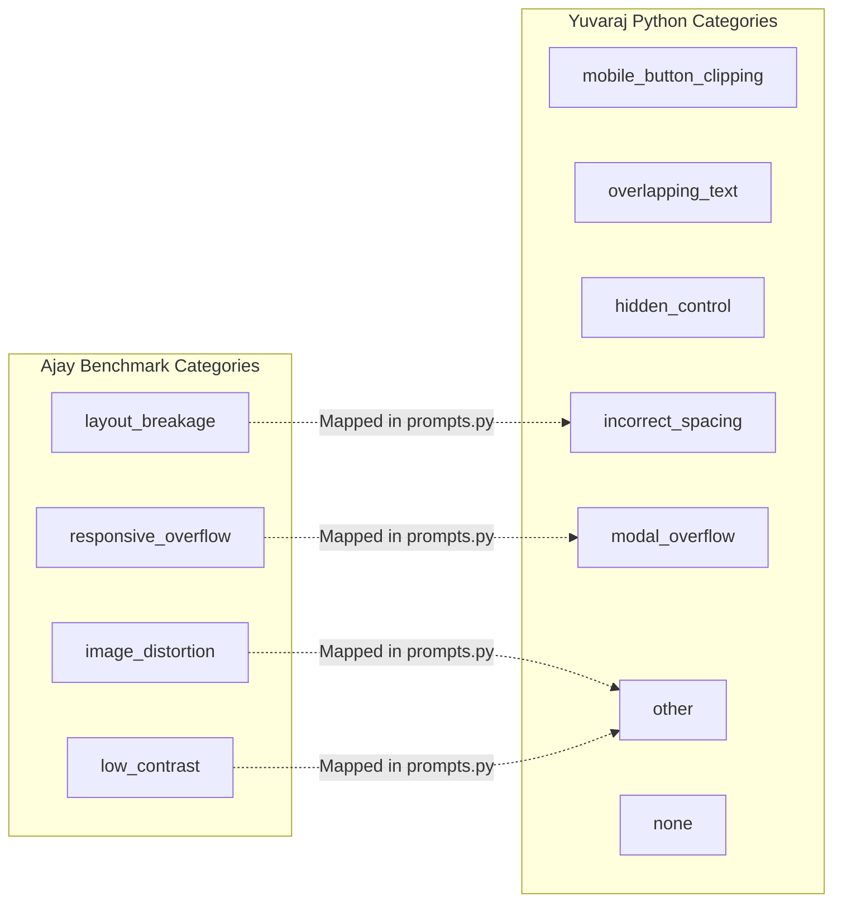

# OmniSight Integration: Diagnosis Contract Comparison

**Status:** Verified Specification  
**Audience:** Ajay (Frontend / Repair), Yuvraj (Python AI Engine), Shilpa (FastAPI Backend / Orchestration)  
**Date:** 2026-11-03  

---

## 1. Overview

This document provides a factual, side-by-side contract comparison between the TypeScript diagnosis schema (`scripts/vlm/diagnosis-schema.ts`) and the Python VLM schema (`ai-engine/schemas.py`). 

Its purpose is to define the exact translation boundaries required for Shilpa's FastAPI backend and orchestrator to consume Yuvraj's AI findings and feed them into Ajay's proposal generator and repair execution engine without altering core model logic.

---

## 2. Schema Definitions

### 2.1 TypeScript Schema (`scripts/vlm/diagnosis-schema.ts`)

```typescript
export type DefectCategory =
  | "image_distortion"
  | "layout_breakage"
  | "low_contrast"
  | "responsive_overflow"
  | "unknown";

export type DefectSeverity = "low" | "medium" | "high" | "critical";

export type DiagnosisStatus = "diagnosed" | "no_defect_detected" | "inconclusive" | "error";

export interface AffectedElementInfo {
  description: string;
  selector?: string | null;
}

export interface DetectedDefect {
  category: DefectCategory;
  severity: DefectSeverity;
  confidence: number; // 0.0 to 1.0
  description: string;
  evidence: string[];
  affected_element: AffectedElementInfo;
  suspected_cause: string;
  suggested_fix: string;
}

export interface StructuredDiagnosis {
  schema_version: "1.0";
  status: DiagnosisStatus;
  summary: string;
  defects: DetectedDefect[];
  limitations: string[];
}

export interface DiagnosisResult {
  scenarioId: string;
  status: DiagnosisStatus;
  diagnosis: StructuredDiagnosis;
  rawResponse?: string;
  model: string;
  provider: string;
  executionTimeMs: number;
  sanitizedEvidenceRef: {
    baselineScreenshot: string;
    defectiveScreenshot: string;
    viewport: { width: number; height: number };
  };
  error?: string;
}
```

### 2.2 Python Schema (`ai-engine/schemas.py`)

```python
class DefectCategory(str, Enum):
    MOBILE_BUTTON_CLIPPING = "mobile_button_clipping"
    OVERLAPPING_TEXT = "overlapping_text"
    HIDDEN_CONTROL = "hidden_control"
    INCORRECT_SPACING = "incorrect_spacing"
    MODAL_OVERFLOW = "modal_overflow"
    OTHER = "other"
    NONE = "none"

class ViewportConfig(BaseModel):
    width: int = Field(default=1280, ge=1)
    height: int = Field(default=720, ge=1)
    is_mobile: bool = Field(default=False)
    device_scale_factor: float = Field(default=1.0, ge=0.5, le=4.0)

class BoundingBox(BaseModel):
    x: float = Field(ge=0.0, le=1.0)
    y: float = Field(ge=0.0, le=1.0)
    width: float = Field(ge=0.0, le=1.0)
    height: float = Field(ge=0.0, le=1.0)

class AIFinding(BaseModel):
    finding_id: str
    job_id: str
    defect_category: DefectCategory
    description: str
    evidence_reference: str
    target_selector: Optional[str] = None
    target_component: Optional[str] = None
    confidence: float = Field(ge=0.0, le=1.0)
    uncertainty_notes: Optional[str] = None
    requires_human_review: bool = False
    suggested_next_step: Optional[str] = None
    bounding_box: Optional[BoundingBox] = None
    created_at: datetime

class AnalysisResponse(BaseModel):
    job_id: str
    has_defect: bool
    findings: List[AIFinding] = []
    analysis_latency_ms: Optional[float] = None
    raw_model_response: Optional[str] = None
    is_mock: bool = False
    provider: str = "mock"
    error: Optional[str] = None
```

---

## 3. Detailed Field Differences

| Concept | TypeScript (`DiagnosisResult` / `DetectedDefect`) | Python (`AnalysisResponse` / `AIFinding`) | Structural Difference |
| :--- | :--- | :--- | :--- |
| **Top-Level Identifier** | `scenarioId: string` | `job_id: str` | TS keys by scenario; Python keys by job |
| **Top-Level Status** | `status: "diagnosed" \| "no_defect_detected" \| "inconclusive" \| "error"` | `has_defect: bool`, `error: Optional[str]` | TS uses explicit enum status; Python uses boolean + error |
| **Latency Metric** | `executionTimeMs: number` | `analysis_latency_ms: Optional[float]` | Float vs integer millisecond naming |
| **Defect List** | `diagnosis.defects: DetectedDefect[]` | `findings: List[AIFinding]` | Nested inside `diagnosis` object in TS |
| **Category Field** | `category: DefectCategory` | `defect_category: DefectCategory` | Renamed field (`category` vs `defect_category`) |
| **Confidence Field** | `confidence: number` (0.0 to 1.0) | `confidence: float` (0.0 to 1.0) | Identical range and semantics |
| **Selector Target** | `affected_element.selector?: string` | `target_selector: Optional[str]` | Nested under `affected_element` in TS; flat in Python |
| **Root Cause / Notes** | `suspected_cause: string` | `uncertainty_notes: Optional[str]` | TS expects mandatory root cause text |
| **Remediation Hint** | `suggested_fix: string` | `suggested_next_step: Optional[str]` | Field naming difference |
| **Severity Rating** | `severity: "low" \| "medium" \| "high" \| "critical"` | *Not present in `AIFinding`* | Python uses `requires_human_review: bool` instead |
| **Evidence Reference** | `evidence: string[]` | `evidence_reference: str` | Array of strings vs single string path |

---

## 4. Category Taxonomy Discrepancy

A critical divergence exists between the two taxonomies:



### The "Other" Ambiguity
In `ai-engine/prompts.py` (line 42), `AJAY_CATEGORY_MAP` maps:
* `product-image-distortion` $\rightarrow$ `"other"`
* `low-contrast-text` $\rightarrow$ `"other"`

**Impact:** If the orchestrator relies solely on Python's `defect_category` to determine the repair patch, both `product-image-distortion` and `low-contrast-text` arrive as `"other"`. In `scripts/repair/patch-registry.ts`, `"other"` has no matching registered patch and will cause the repair engine to exit with `UNSUPPORTED`.

---

## 5. Required Translation / Mapping

When Shilpa's FastAPI backend receives an `AnalysisResponse` from Yuvraj's Python VLM engine and provides it to the frontend or repair proposal service, the following mapping must occur:

```python
def map_python_finding_to_ts_defect(finding: AIFinding, scenario_id: str) -> dict:
    # 1. Reverse-map category using scenario_id fallback if defect_category is 'other'
    category_map = {
        "modal_overflow": "responsive_overflow",
        "incorrect_spacing": "layout_breakage",
        "overlapping_text": "layout_breakage",
        "mobile_button_clipping": "responsive_overflow",
    }
    
    category = category_map.get(finding.defect_category.value, "unknown")
    if category == "unknown":
        if "image-distortion" in scenario_id:
            category = "image_distortion"
        elif "contrast" in scenario_id:
            category = "low_contrast"

    # 2. Derive severity from confidence and human review flag
    severity = "high" if finding.requires_human_review else ("medium" if finding.confidence > 0.7 else "low")

    return {
        "category": category,
        "severity": severity,
        "confidence": finding.confidence,
        "description": finding.description,
        "evidence": [finding.evidence_reference] if finding.evidence_reference else ["visual-inspection"],
        "affected_element": {
            "description": finding.target_component or "Identified UI Element",
            "selector": finding.target_selector
        },
        "suspected_cause": finding.uncertainty_notes or "Visual layout anomaly detected by VLM",
        "suggested_fix": finding.suggested_next_step or "Inspect and update CSS rules"
    }
```

---

## 6. How `scenario_id` is Preserved

1. **Frontend / Browser Automation:** Every injected test scenario has a known ID (e.g., `product-image-distortion`, `product-card-layout-break`, `low-contrast-text`, `mobile-nav-overflow`).
2. **Backend Contract V2:** Shilpa's routes explicitly index scenarios:
   * `POST /jobs/{id}/scenarios/{scenario_id}/diagnose`
   * `GET /jobs/{id}/scenarios/{scenario_id}/diagnosis`
   * `POST /jobs/{id}/scenarios/{scenario_id}/repair`
3. **Python AI Engine:** Receives `job_id` and `route`/`step_name` inside `EvidenceContext`. 
4. **Preservation Rule:** The backend must attach `scenario_id` to `EvidenceContext` (via route or context metadata) and preserve it in the resulting diagnosis response so the downstream proposal generator can locate the target source files.

---

## 7. How Registered Patch IDs are Resolved

1. **AI Output:** Neither `AIFinding` nor `PatchProposal` in `ai-engine/schemas.py` generates or assigns a registered `patch_id`. Models output general descriptions, diffs, or bounding boxes.
2. **Registry Lookup:** Patch IDs belong strictly to Ajay's deterministic registry (`scripts/repair/patch-registry.ts`).
3. **Resolution Flow:**
   ```
   scenario_id / category ──> CATEGORY_TO_PATCH_MAP ──> approvedPatchId ──> RepairExecutionService
   ```
4. **Conclusion:** Patch ID selection is a deterministic backend/orchestrator routing step, not an AI generation step.

