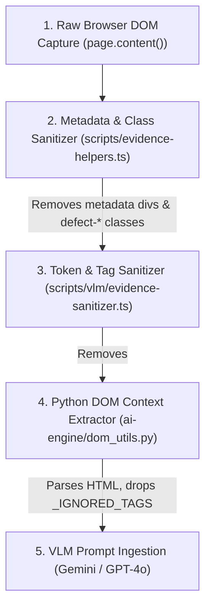

# OmniSight Security & Dataset Investigation: DOM Sanitizer Findings

**Status:** Technical Investigation & Audit Finding  
**Scope:** Investigation of Ground-Truth Leakage Concerns (`defect-mobile-nav-overflow`)  
**Investigator:** Senior Software Integration Engineer  
**Date:** 2026-11-03  

---

## 1. Executive Summary

During pre-integration reviews, a concern was raised regarding whether seeded defect identifiers—specifically `defect-mobile-nav-overflow`—might leak into the sanitized DOM snapshots and visual evidence bundles delivered to Yuvraj's AI diagnosis engine.

An exhaustive audit of the sanitization pipeline and the actual evaluation bundle (`artifacts/visual-evidence/run-2026-10-13T17-36-08-002Z/`) confirmed:
1. **Zero Ground-Truth Leakage in Model-Facing DOM:** In the defective HTML file (`dom-defective.html`), the class attribute `defect-mobile-nav-overflow` was cleanly stripped from all DOM elements.
2. **Intermediate CSS Trailing-Dot Discovered:** An embedded `<style>` block contained `.navbar. .navbar-container`, which occurred because regex replacement stripped the class name but left behind a trailing dot.
3. **Confirmed No Impact on AI Models:** This trailing dot was confined to a raw snapshot `<style>` block. Both the dedicated prompt sanitizer (`sanitizeDomForVlm`) and Yuvraj's Python DOM parser (`_IGNORED_TAGS` in `dom_utils.py`) completely strip all `<style>` elements before prompt assembly.

---

## 2. Multi-Stage Sanitization Pipeline

The DOM extraction and sanitization pipeline operates through three distinct layers:



### Stage 1: Inspection Metadata & Defect Class Stripping (`scripts/evidence-helpers.ts`)
* Strips `<div id="omnisight-defect-metadata">`.
* Strips `data-defect-applied` and `data-defect-injection-enabled` attributes.
* Replaces defect classes: `cleaned = cleaned.replace(/\s*defect-[a-z0-9-]+/gi, "");`.

### Stage 2: Token-Efficient VLM Prompt Sanitizer (`scripts/vlm/evidence-sanitizer.ts`)
* Strips development tags, local filesystem paths (`/Users/...`), and Vite refresh scripts.
* Eliminates all CSS comments (`/\*[\s\S]*?\*/g`).
* Strips defect classes using word boundaries (`/\bdefect-[a-z0-9-]+\b/gi`).
* **Crucially, completely removes `<style>` and `<head>` tags:**
  ```typescript
  cleaned = cleaned.replace(/<style\b[^<]*(?:(?!<\/style>)<[^<]*)*<\/style>/gi, "");
  ```

### Stage 3: Python DOM Context Filter (`ai-engine/dom_utils.py`)
* Yuvaraj's parser defines:
  ```python
  _IGNORED_TAGS = {"script", "style", "meta", "link", "noscript"}
  ```
  During DOM tree traversal, any style blocks that exist in the input string are discarded and never converted into text tokens.

---

## 3. Physical Evidence from the Evaluation Dataset

Inspection of [`artifacts/visual-evidence/run-2026-10-13T17-36-08-002Z/mobile-nav-overflow/dom-defective.html`](file:///Users/ajaykowkuntla/Desktop/%20OmniSight/artifacts/visual-evidence/run-2026-10-13T17-36-08-002Z/mobile-nav-overflow/dom-defective.html):

### 3.1 DOM Element Inspection
Line 1666 of `dom-defective.html`:
```html
<header class="navbar" data-testid="navbar">
  <div class="navbar-container">
    <a class="navbar-logo" aria-label="OmniShop Home" href="/">...</a>
    <nav class="navbar-nav" aria-label="Main Navigation">
      <a class="nav-link" href="/">Home</a>
      ...
    </nav>
  </div>
</header>
```
* **Finding:** The defect class `defect-mobile-nav-overflow` is **completely absent** from the element's class attribute. The model cannot read the defect identity from element attributes.

### 3.2 The Embedded CSS Trailing-Dot Artifact
In lines 1649–1659 of `dom-defective.html` inside the `<style>` tag:
```css
/* Lines 1649-1659 of dom-defective.html */
.navbar. .navbar-container {
  width: 650px;
  min-width: 650px;
}
.navbar. .navbar-nav {
  gap: 2.5rem;
  min-width: 450px;
}
.navbar. .nav-link {
  white-space: nowrap;
  padding: 0.75rem 1.75rem;
}
```
* **Root Cause:** In `src/index.css`, the injected rule was `.navbar.defect-mobile-nav-overflow .navbar-container`. The Stage 1 regex `replace(/\s*defect-[a-z0-9-]+/gi, "")` removed the substring `defect-mobile-nav-overflow`, leaving `.navbar. .navbar-container`.
* **Classification:** This is an intermediate string replacement cosmetic artifact, **not** a ground-truth leak:
  * The defect name `defect-mobile-nav-overflow` does not appear anywhere in the string.
  * The `<style>` tag is discarded by Stage 2 and Stage 3 prior to reaching the VLM.

---

## 4. Why Ground-Truth Isolation is Critical for VLM Evaluation

1. **Benchmark Integrity:** A multimodal model evaluated on visual UI defect detection must infer defects from layout geometry, rendered pixels, visual hierarchy, and element bounding boxes.
2. **Eliminating Textual Shortcuts:** If a DOM snippet contains `class="defect-mobile-nav-overflow"` or `/* Defect: mobile-nav-overflow */`, an LLM will simply perform string matching on the prompt text and achieve artificial 100% precision without looking at the screenshot.
3. **Conclusion:** Because the defect identifier is completely eliminated and styles are excluded from prompt construction, the evaluation dataset in `artifacts/visual-evidence/run-2026-10-13T17-36-08-002Z/` is safe and verified free of ground-truth leakage.

