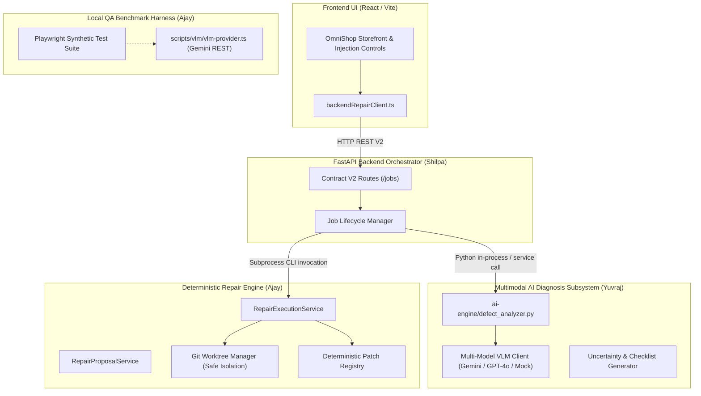

# OmniSight Integration: Provider Architecture & Subsystem Division

**Status:** Proposed Architecture (Requires Formal Review by Shilpa & Yuvraj)  
**Author:** Ajay (Senior Software Integration Engineer)  
**Date:** 2026-11-03  

---

## 1. Overview & Subsystem Responsibilities

The OmniSight autonomous visual repair system consists of four distinct components spread across TypeScript and Python. Below is a detailed breakdown of each component's design, operational role, and boundaries.



---

## 2. Component Responsibility Matrix

### 2.1 Python VLM Engine (`ai-engine/` — Owner: Yuvraj)
* **Core Role:** Production multimodal diagnosis and visual defect detection.
* **Responsibilities:**
  1. Accepts screenshots (baseline and defective), viewport specifications, and sanitized DOM context.
  2. Orchestrates vision models (Gemini 1.5 Pro/Flash, OpenAI GPT-4o, or local mock).
  3. Detects visual defects using specialized prompts, few-shot visual examples, and system instructions.
  4. Computes confidence scores, uncertainty estimates, and bounding box coordinates.
  5. Emits structured `AnalysisResponse` containing `AIFinding` records.
  6. Generates automated validation checklists (`ValidationChecklist`) for post-repair verification.

### 2.2 TypeScript Gemini Provider (`scripts/vlm/vlm-provider.ts` — Owner: Ajay)
* **Core Role:** Lightweight evaluation harness for frontend test automation.
* **Responsibilities:**
  1. Provides a zero-dependency, pure TypeScript interface to Google's Generative Language API.
  2. Enables offline synthetic dataset validation (`tests/vlm-diagnosis.spec.ts`) without requiring Python runtime setup on frontend development machines.
  3. Acts as a baseline comparison and smoke-testing tool for the visual evidence dataset.
* **Design Note:** Not intended to replace or compete with Yuvraj's Python AI engine. It is strictly a QA evaluation fixture.

### 2.3 TypeScript Proposal Generator (`scripts/vlm/repair-proposal-service.ts` — Owner: Ajay)
* **Core Role:** Non-destructive source code localization and repair proposal generation.
* **Responsibilities:**
  1. Consumes structured diagnosis data (`DiagnosisResult`).
  2. Performs source code localization (`SourceLocalizationService`) to identify the candidate CSS rules or React components in `src/`.
  3. Verifies source file security and hash freshness (`source-path-security.ts`) to prevent path traversal or stale edits.
  4. Generates immutable `RepairProposal` objects for human operator review before worktree execution.

### 2.4 TypeScript Repair Execution Engine (`scripts/repair/repair-execution-service.ts` — Owner: Ajay)
* **Core Role:** Isolated Git worktree execution, patch application, and multi-tier verification.
* **Responsibilities:**
  1. Validates operator approval and job contract parameters (`RepairJobContract`).
  2. Creates isolated Git worktrees and temporary branches (`omnisight-repair/<jobId>`) using safe path whitelisting.
  3. Applies deterministic patches from `REGISTERED_PATCHES`.
  4. Runs verification pipeline:
     * Syntax validation.
     * TypeScript compilation (`npm run build`).
     * Automated regression tests.
     * Playwright browser-based visual validation metrics.
  5. In `commit` or `pr` mode: commits the fix, generates a commit hash (`commitSha` / `commit_sha`), and preserves the repair branch.
  6. Safely cleans up worktrees and writes `repair_execution_report.json`.

---

## 3. Proposed End-to-End Orchestration Architecture

### 3.1 Job Flow
1. **Creation:** Frontend calls `POST /jobs` $\rightarrow$ Shilpa's backend initializes the job session and registers scenarios.
2. **Diagnosis Phase:**
   * Frontend calls `POST /jobs/{id}/scenarios/{scenario_id}/diagnose`.
   * Backend collects evidence screenshots and sanitized DOM from browser runner.
   * Backend invokes Yuvraj's `DefectAnalyzer` (`ai-engine/defect_analyzer.py`).
   * Backend converts `AnalysisResponse` into `StructuredDiagnosis` and stores it.
3. **Review Phase:**
   * Frontend calls `GET /jobs/{id}/scenarios/{scenario_id}/diagnosis` to display findings, confidence scores, and bounding boxes.
   * Operator or automated policy approves the repair patch.
4. **Repair Phase:**
   * Frontend calls `POST /jobs/{id}/scenarios/{scenario_id}/repair` with `{"patch_id": "...", "mode": "commit"}` and `X-Operator-Token`.
   * Backend maps the scenario to the verified `approvedPatchId`.
   * Backend triggers Ajay's repair engine CLI:
     ```bash
     npx ts-node scripts/repair/repair-cli.ts \
       --job-id <id> \
       --scenario-id <scenario_id> \
       --patch-id <patch_id> \
       --mode commit
     ```
   * Repair engine executes in an isolated worktree and writes:
     `<repoRoot>/artifacts/repair-executions/<job_id>/repair_execution_report.json`
   * Backend polls/awaits completion and exposes status via `GET /jobs/{id}/scenarios/{scenario_id}/repair`.

---

## 4. Open Architecture Questions Requiring Approval

1. **Subprocess vs HTTP Service for Repair Execution:**
   * *Option A (Recommended for Milestone 2):* Shilpa's FastAPI backend invokes `repair-cli.ts` as a local subprocess, reading `repair_execution_report.json` from the shared filesystem.
   * *Option B (Future Microservice):* Wrap Ajay's repair engine in a standalone Node.js REST API or worker queue.
2. **Category Taxonomy Harmonization:**
   * Yuvraj and Ajay must agree whether to expand `DefectCategory` in `ai-engine/schemas.py` to natively include `image_distortion` and `low_contrast`, or retain `AJAY_CATEGORY_MAP` and rely on `scenario_id` for patch resolution.

