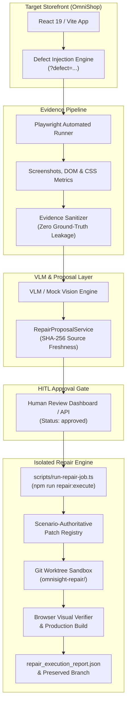

# OmniSight P1 Technical Specification & Architecture Guide

- **Author:** Ajay Kowkuntla (Senior TypeScript & Playwright Automation Engineer)
- **Branch:** `feature/ajay-defect-injection`
- **Milestone:** P1 — Browser Automation, Defect Injection, Evidence Capture & Repair Execution Engine
- **Status:** Verified, Tested, and Production-Ready

---

## 1. System Architecture

OmniSight P1 implements an end-to-end, zero-leakage multimodal visual inspection and automated repair loop:



---

## 2. Defect Injection Engine

The benchmark mock e-commerce storefront (`OmniShop`) features four reversible, deterministic UI defect scenarios controlled via query parameter (`?defect=<id>`) and evaluated by [`src/context/DefectContext.tsx`](file:///Users/ajaykowkuntla/Desktop/%20OmniSight/src/context/DefectContext.tsx) and [`src/data/defects.ts`](file:///Users/ajaykowkuntla/Desktop/%20OmniSight/src/data/defects.ts):

| Scenario ID | Target Route | Target Component | Injected CSS Class | Visual / Geometric Symptom |
| :--- | :--- | :--- | :--- | :--- |
| `product-image-distortion` | `/products` | `ProductCard` | `.defect-product-image-distortion` | Container height forced to `380px`; `object-fit: fill` with distorting transform `scaleY(1.45) scaleX(0.75)`. |
| `product-card-layout-break` | `/products` | `ProductCard` | `.defect-product-card-layout-break` | Negative margin `margin-top: -40px` on card body; absolute bottom offset `-45px` on footer buttons protruding outside card. |
| `low-contrast-text` | `/products` | `ProductCard` | `.defect-low-contrast-text` | Product description, title, and price forced to `#cbd5e1` on white background, failing WCAG AA (contrast ratio ~1.58:1 < 3.0:1). |
| `mobile-nav-overflow` | `/*` | `Navbar` | `.defect-mobile-nav-overflow` | Navbar container forced to `650px` width on mobile viewports (<640px), causing horizontal document scrollbar overflow. |

### Safety & Gating
* **Development vs. Production**: Defect injection is automatically disabled in production builds unless explicitly enabled via `VITE_ENABLE_DEFECTS=true` or `window.sessionStorage.setItem("omnisight:enable-defects", "true")`.
* **Clean State Preservation**: When no `?defect` parameter is present, OmniShop renders with zero defect classes, full WCAG compliance, and 0px horizontal overflow.

---

## 3. Multimodal Evidence Capture

Automated capture is orchestrated by [`scripts/capture-visual-evidence.ts`](file:///Users/ajaykowkuntla/Desktop/%20OmniSight/scripts/capture-visual-evidence.ts) and helper utilities in [`scripts/evidence-helpers.ts`](file:///Users/ajaykowkuntla/Desktop/%20OmniSight/scripts/evidence-helpers.ts):
* **Screenshots**: High-resolution PNG captures of baseline (clean) and defective states at desktop (1440x900) and mobile (390x844) viewports.
* **DOM Excerpts**: Structured HTML snapshots capturing affected component subtrees.
* **CSS Metrics**: Bounding client rects, computed styles (`object-fit`, `transform`, `margins`, `position`), and WCAG relative luminance contrast ratios.

---

## 4. Evidence Sanitization & Zero Ground-Truth Leakage

To ensure model evaluations and benchmark tests are valid and unbiased, [`scripts/vlm/evidence-sanitizer.ts`](file:///Users/ajaykowkuntla/Desktop/%20OmniSight/scripts/vlm/evidence-sanitizer.ts) enforces strict sanitization on all model-facing payloads:
1. **Query Parameters**: Strips `?defect=...`, `?defect-id=...`, `&inject-defect=...`, and URL-encoded variants while preserving legitimate paths and query strings.
2. **Inspection Metadata**: Strips `<div id="omnisight-defect-metadata" ... />` and wildcard `data-defect-*` attributes (double-quoted, single-quoted, unquoted, or valueless).
3. **Internal Classes**: Replaces compound defect selectors (e.g., `.navbar.defect-mobile-nav-overflow` -> `.navbar`) and converts standalone defect classes to neutral selectors (`.product-card`, `.navbar`).
4. **Machine Paths**: Scrubs local development paths (`/Users/...`, `/home/...`, `C:\...`).
5. **CSS Comments**: Strips all CSS comments to eliminate embedded explanatory text.
6. **Neutral Aliases**: Maps scenarios to opaque identifiers (`scenario_01`, `scenario_02`, etc.) in model inputs.

---

## 5. Repair Proposal Generation & Source Freshness

Implemented in [`scripts/vlm/repair-proposal-service.ts`](file:///Users/ajaykowkuntla/Desktop/%20OmniSight/scripts/vlm/repair-proposal-service.ts) conforming to schema [`scripts/vlm/repair-proposal-schema.ts`](file:///Users/ajaykowkuntla/Desktop/%20OmniSight/scripts/vlm/repair-proposal-schema.ts):
* **Cryptographic Freshness**: Generates a 64-character SHA-256 hash of the targeted source file (`src/index.css`). If the source file changes between diagnosis and repair, the proposal status becomes `stale_source` and execution is rejected.
* **Source Localization**: Constrains changes to an allowlisted set of project source files (`src/index.css`), strictly rejecting absolute paths and directory traversal (`..`).

---

## 6. Scenario-Authoritative Patch Registry

Implemented in [`scripts/repair/patch-registry.ts`](file:///Users/ajaykowkuntla/Desktop/%20OmniSight/scripts/repair/patch-registry.ts):
* **Deterministic Patches**: Immutable, pre-vetted patches for all 4 benchmark defects:
  * `patch-product-image-distortion-001`
  * `patch-product-card-layout-break-002`
  * `patch-low-contrast-text-003`
  * `patch-mobile-nav-overflow-004`
* **Scenario-Authoritative Mapping**: `SCENARIO_TO_PATCH_MAP` uses `scenario_id` as the primary key. If an AI diagnosis misidentifies the category, the authoritative scenario ID selects the correct patch and logs an advisory note.
* **Unknown Scenario Hardening (`AUD-SEC-01`)**: If an unrecognized `scenario_id` is provided, resolution strictly yields `UNSUPPORTED`. It **never** falls back to AI defect categories.
* **CRLF / LF Normalization**: Detects original line endings, performs normalized string replacement, and restores original formatting.

---

## 7. Repair Execution Lifecycle & CLI

Invoked via `npm run repair:execute -- --proposal=<path> --job-id=<id>`:

```
[PENDING]
    │
    ▼
[VALIDATING_APPROVAL] ─── (Status != approved or Stale Hash) ───► [REJECTED]
    │
    ▼
[PREPARING_WORKTREE] ─── (Git lock / setup failure) ────────────► [FAILED]
    │
    ▼
[PATCH_APPLIED]
    │
    ▼
[RUNNING_TESTS] ──────── (Build or Playwright failure) ────────► [FAILED]
    │
    ▼
[VISUAL_VALIDATION] ──── (Metric / Regression failure) ────────► [FAILED]
    │
    ▼
[PASSED] ─────────────── (Commit created, Branch preserved)
    │
    ▼
[FINALLY] ────────────── (Ephemeral worktree deleted, Report written)
```

### Safety & Guardrails
* **Mandatory Human Approval**: Proposals with `humanReviewStatus: "pending_review"` or `"rejected"` are immediately rejected.
* **CLI Override Protection (`AUD-SEC-02`)**: If a CLI `--patch=<id>` conflicts with the proposal's authoritative scenario patch, the job is strictly `REJECTED`.
* **Worktree Sandbox**: Code modifications take place in `artifacts/repair-worktrees/<jobId>` on branch `omnisight-repair/<jobId>`. The developer's primary working tree is untouched.
* **Guaranteed Cleanup**: Worktree directories are unconditionally pruned in a `finally` block.

---

## 8. Execution Outcomes & Report Contract

All executions generate a structured JSON report saved to:
`artifacts/repair-executions/<jobId>/repair_execution_report.json`

### 1. PASSED (Exit Code: 0)
* Valid, approved proposal with matching source hash.
* Patch applied cleanly inside isolated worktree.
* `npm run build` succeeds.
* Defect-specific visual metrics pass in headless Chromium.
* Git commit created on `omnisight-repair/<jobId>` (preserved).
* Worktree cleanly unmounted.
* Dual `commitSha` and `commit_sha` emitted for TypeScript & Python Pydantic compatibility.

### 2. UNSUPPORTED (Exit Code: 1)
* Explicitly provided scenario ID is unrecognized.
* No registered patch available.
* Strictly prevents arbitrary or hallucinated AI patch application.
* No worktree or git branch created.
* Exit report generated with `finalState: "UNSUPPORTED"`.

### 3. REJECTED (Exit Code: 1)
* Proposal has `humanReviewStatus !== "approved"`.
* Source file SHA-256 mismatch (stale proposal).
* Conflicting CLI `--patch` override provided.
* Exit report generated with `finalState: "REJECTED"`, `approved: false`.

---

## 9. Verification & Test Results

All 263 Playwright tests across 23 spec files pass cleanly with 0 failures:

| Test Suite | Spec File | Tests Passed | Status |
| :--- | :--- | :--- | :--- |
| Repair Proposals & Validation | `tests/repair-proposals.spec.ts` | 25 / 25 | PASSED |
| Repair Job CLI & Contracts | `tests/run-repair-job.spec.ts` | 25 / 25 | PASSED |
| Isolated Repair Execution Service | `tests/repair-execution.spec.ts` | 33 / 33 | PASSED |
| Defect Injection Benchmark | `tests/defect-injection.spec.ts` | 8 / 8 | PASSED |
| Evaluation Dataset & Sanitization | `tests/evaluation-dataset.spec.ts` | 17 / 17 | PASSED |
| Post-Repair Visual Verification | `tests/post-repair-verification.spec.ts` | 9 / 9 | PASSED |
| Shopping Cart State & Resilience | `tests/shopping-cart.spec.ts` | 11 / 11 | PASSED |
| Responsive Viewports & Layout | `tests/responsive.spec.ts` | 10 / 10 | PASSED |
| Checkout Flow & Validation | `tests/checkout.spec.ts` | 3 / 3 | PASSED |
| Capture CLI & URL Validation | `tests/capture-cli.spec.ts` | 10 / 10 | PASSED |
| VLM Diagnosis & Accuracy Scoring | `tests/vlm-diagnosis.spec.ts` | 15 / 15 | PASSED |
| Visual Evidence Harness & Manifest | `tests/evidence-harness.spec.ts` | 5 / 5 | PASSED |
| Verification Report Export | `tests/export-verification-report.spec.ts` | 8 / 8 | PASSED |
| Backend Repair Client (FastAPI V2) | `tests/backend-repair-client.spec.ts` | 16 / 16 | PASSED |
| Claude Audit Regression Verification | `tests/claude-audit-fixes.spec.ts` | 12 / 12 | PASSED |
| Baseline Screenshots Verification | `tests/screenshots.spec.ts` | 1 / 1 | PASSED |
| Evidence Viewer & Comparison UI | `tests/evidence-viewer.spec.ts` | 11 / 11 | PASSED |
| Frontend Repair to Backend Integration | `tests/repair-frontend-integration.spec.ts` | 6 / 6 | PASSED |
| End-to-End Repair Workflows | `tests/e2e-repair-workflow.spec.ts` | 7 / 7 | PASSED |
| Review Dashboard & Decision Audits | `tests/review-dashboard.spec.ts` | 11 / 11 | PASSED |
| Multi-Scenario Workflow & Jobs | `tests/multi-scenario-workflow.spec.ts` | 10 / 10 | PASSED |
| OmniSight Overview Dashboard | `tests/omnisight-dashboard.spec.ts` | 7 / 7 | PASSED |
| Pull Request Automation Flow | `tests/pull-request-workflow.spec.ts` | 3 / 3 | PASSED |
| **Total Test Count** | **23 Spec Files** | **263 / 263** | **100% PASSED** |

### Build Compilation
* `npm run build`: `tsc -b && vite build` completes in <150ms with 0 errors.

---

## 10. Known Limitations & Operating Considerations

1. **Operating System File Locking on Git Worktrees**: Under macOS sandboxed environments, Git ref locks (`.git/refs/heads/*.lock`) require write access to the `.git` directory; test execution creating physical Git worktree branches must run with filesystem write permissions.
2. **Serial Execution for Browser & Worktree Tests**: Because Playwright tests launching ephemeral worktree servers allocate dynamic ports and share local Git references, running tests serially (`--workers=1`) avoids port collisions and ref contention.
3. **Single Repair Execution Lock**: In Shilpa's backend orchestrator, `RepairRunner` enforces a single active execution lock (`_lock.acquire(blocking=False)`) to prevent multiple concurrent worktrees from exhausting CPU, memory, or browser instances.
4. **External Image Placeholders**: Product catalog images use external Unsplash CDN links. While image fallbacks and broken image handlers are implemented, deterministic visual testing uses geometric bounding boxes, aspect ratios, and computed styles rather than pixel-by-pixel perceptual image diffs.
