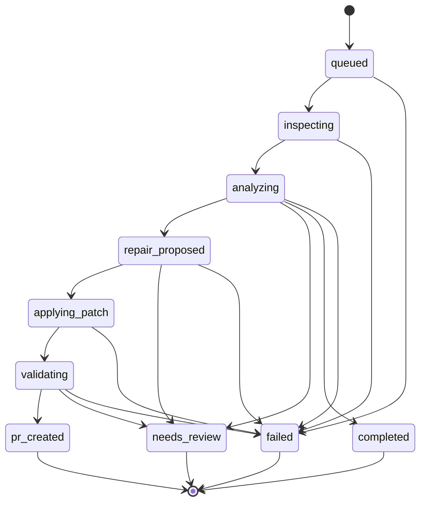

# OmniSight — P4 API Contracts & Coordination Document

**Author:** Person 4 (GitHub Integration & QA Dashboard — Sahil)  
**Date:** October 2026  
**Status:** Active Working Specification  

---

## 1. Executive Summary

This document formalizes the frontend API contracts, TypeScript interfaces, and integration boundaries for **OmniSight's QA Dashboard (P4)**. It details the actual schemas discovered across repository branches:
- **Person 3 (Backend Orchestrator):** `backend/job_schemas.py` and `backend/api.py`
- **Person 2 (AI Engine):** `ai-engine/schemas.py`
- **Person 1 (Playwright Automation & Storefront):** `artifacts/screenshots` capture conventions

It clearly distinguishes **confirmed contracts** (already running in backend code) from **proposed/extended contracts** (needed for full Days 11–20 UI capabilities), and raises specific coordination questions for the backend team.

---

## 2. Confirmed Backend Contracts (Person 3)

The following endpoints and Pydantic schemas have been implemented by Person 3 in `backend/api.py` and `backend/job_schemas.py`.

### 2.1 Backend Endpoints

| Method | Endpoint | Description | Request Payload | Response Model |
| :--- | :--- | :--- | :--- | :--- |
| `GET` | `/health`, `/api/health` | Service health check | None | `{"status": "ok"}` |
| `POST` | `/jobs`, `/api/jobs` | Intakes a manual inspection job | `JobCreateRequest` | `JobResponse` (201) |
| `GET` | `/jobs`, `/api/jobs` | Paginated list of inspection jobs | Query: `status`, `limit`, `offset` | `JobListResponse` (200) |
| `GET` | `/jobs/{job_id}`, `/api/jobs/{job_id}` | Detailed inspection job record | None | `JobResponse` (200) |
| `GET` | `/jobs/{job_id}/artifacts`, `/api/jobs/{job_id}/artifacts` | List of evidence artifacts for a job | None | `List[ArtifactRef]` (200) |
| `POST` | `/webhooks/ci`, `/api/webhooks/ci` | CI build trigger webhook | `CIWebhookRequest` | `CIWebhookResponse` (201) |

### 2.2 Backend Job State Machine (`JobStatus`)

The backend orchestrator defines an explicit state machine with permitted transitions:



Confirmed string values:
- `"queued"`
- `"inspecting"`
- `"analyzing"`
- `"repair_proposed"`
- `"applying_patch"`
- `"validating"`
- `"pr_created"`
- `"needs_review"`
- `"completed"` (inspection clean; nothing to repair)
- `"failed"`

### 2.3 Artifact References (`ArtifactRef`)

The backend stores artifact metadata only (never raw image binaries in SQLite):

```json
{
  "artifact_id": "art_a1b2c3d4",
  "kind": "screenshot",
  "uri": "artifacts/JOB-1084/01-home-desktop.png",
  "description": "Desktop viewport home page capture",
  "mock": false,
  "created_at": "2026-10-16T22:20:14Z"
}
```

- Allowed `kind` values: `"screenshot" | "dom_snapshot" | "trace" | "log" | "other"`
- `uri`: File path or URI (`mock://` indicates placeholder/mock mode)

### 2.4 Inspection Summary (`Inspection`)

```json
{
  "mode": "playwright",
  "executed": true,
  "message": "Playwright multi-viewport scan completed successfully",
  "run_id": "run_20261016_222014",
  "exit_code": 0,
  "duration_seconds": 38.5,
  "scenarios_captured": 7,
  "total_scenarios": 7,
  "stdout_tail": "...",
  "stderr_tail": null
}
```

---

## 3. Confirmed AI Engine Contracts (Person 2)

Defined by Person 2 in `ai-engine/schemas.py`:

### 3.1 Defect Taxonomy (`DefectCategory`)
- `mobile_button_clipping`
- `overlapping_text`
- `hidden_control`
- `incorrect_spacing`
- `modal_overflow`
- `other`
- `none`

### 3.2 AI Finding Structure (`AIFinding`)
- `finding_id`: string (e.g. `fnd_a1b2c3d4`)
- `job_id`: string
- `defect_category`: `DefectCategory`
- `description`: string
- `evidence_reference`: string (matches an `artifact_id` or screenshot path)
- `target_selector`: string (optional DOM selector, e.g. `.checkout-form .card-expiry-row`)
- `target_component`: string (optional component file, e.g. `PaymentForm.tsx`)
- `confidence`: float (0.0 to 1.0)
- `uncertainty_notes`: string (optional)
- `requires_human_review`: boolean
- `suggested_next_step`: string (optional)
- `bounding_box`: `{ x: float, y: float, width: float, height: float }` (normalized [0, 1])

### 3.3 Patch Proposal (`PatchProposal`)
- `finding_id`: string
- `category`: `DefectCategory`
- `summary`: string
- `changes`: `List[CodeChange]` (`file_path`, `description`, `unified_diff`)
- `validation`: `ValidationChecklist` (`steps`, `expected_outcome`, `viewports`, `selectors_to_check`)
- `confidence`: float
- `requires_human_review`: boolean

---

## 4. Frontend Type Architecture (Person 4)

In `src/types/`, Person 4 has structured these contracts into clean, typed modules:

```
src/types/
├── contracts.ts    # Direct 1:1 reflection of backend & AI engine Pydantic schemas
├── dashboard.ts    # Frontend domain models, UI badge mappings, & runtime type guards
└── index.ts        # Unified re-export entrypoint
```

### 4.1 Backend Status to UI Badge Status Mapping

| Backend `JobStatus` | Frontend `BadgeStatus` | UI Label | Visual Variant |
| :--- | :--- | :--- | :--- |
| `queued` | `pending` | Pending | Muted gray |
| `inspecting`, `analyzing`, `applying_patch`, `validating` | `running` | Running | Pulsing blue |
| `completed`, `pr_created` | `passed` | Passed / Healed | Emerald green |
| `failed` | `failed` | Failed | Red |
| `repair_proposed`, `needs_review` | `needs-review` | Needs Review | Amber / Orange |

Implemented via `backendJobStatusToBadgeStatus(status)` in `src/types/dashboard.ts`.

### 4.2 Lightweight Runtime Type Guards

Zero-dependency runtime validation helpers in `src/types/dashboard.ts`:
- `isBackendJobResponse(val: unknown): val is BackendJobResponse`
- `isDefectFinding(val: unknown): val is DefectFinding`
- `isInspectionEvidence(val: unknown): val is InspectionEvidence`
- `isJobValidationResult(val: unknown): val is JobValidationResult`

---

## 5. Proposed Extensions & UI Requirements

To support the rich visual triage features created in Days 4–9, the frontend proposes the following data fields for subsequent backend iterations:

| Entity | Proposed Field | Reason / Usage | Status |
| :--- | :--- | :--- | :--- |
| `ArtifactRef` | `baseline_uri` | Allows side-by-side comparison in `VisualEvidenceViewer` | Proposed for Week 2 |
| `ArtifactRef` | `dimensions`, `viewport_name` | Displays resolution tags (`1440 × 900`, `390 × 844`) in the UI | Proposed |
| `JobResponse` | `validation_summary` | Summary of re-validation assertions executed after patch application | Proposed for Day 15 |
| `JobResponse` | `pr_metadata` | GitHub PR URL, branch name, and review decision for Day 18 PR workflows | Proposed for Day 18 |

---

## 6. Open Coordination Questions for Person 3 & Person 2

1. **Screenshot & Asset Serving:**
   - *Question:* How will image binaries referenced in `ArtifactRef.uri` be served to the browser?
   - *Proposed Solution:* FastAPI should mount a static route (e.g. `app.mount("/artifacts", StaticFiles(directory="artifacts"), name="artifacts")`), or return absolute/relative URLs that Vite dev proxy can forward.

2. **Error Response Schema:**
   - *Question:* Does the backend standardize on `{ "detail": string }` or an envelope `{ "error": string, "code": string }`?
   - *Current Observation:* `backend/api.py` raises standard `HTTPException(status_code, detail=...)`. Frontend `OmniSightApiClient` handles `{ detail }` safely.

3. **Validation Outcome Endpoint:**
   - *Question:* During the `validating` state, will individual check assertions (`ValidationCheck[]`) be embedded directly on `GET /jobs/{id}` or fetched via a sub-route `GET /jobs/{id}/validation`?
   - *Frontend Readiness:* The frontend handles either option through `ValidationResultsProps`.

4. **GitHub PR Creation Webhook/Action:**
   - *Question:* Will P3 or P4 trigger the GitHub PR creation API?
   - *Recommendation:* P3 orchestrator executes Git branch creation and GitHub API interaction; P4 provides the approval/reject UI controls on the dashboard.
