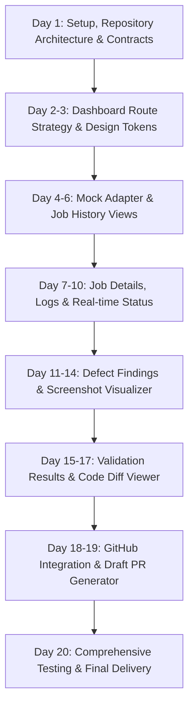

# P4: GitHub Integration & QA Dashboard — Development Setup & Architecture

**Engineer / Workstream:** Sahil — P4 (GitHub Integration & QA Dashboard)  
**System:** OmniSight (AI-powered UI defect detection & self-healing platform)  
**Document Version:** Day 1 Baseline Setup  
**Date:** October 2026  

---

## 1. Role Scope and P4 Responsibilities

As the engineer for **P4: GitHub Integration & QA Dashboard**, the primary objective is to deliver the human-in-the-loop and automated integration interface for the OmniSight platform.

### Core Responsibilities:
1. **React-Based QA Dashboard:**
   - Dedicated dashboard interface to monitor UI inspection runs and system telemetry.
   - Intuitive presentation of test targets, run logs, and overall pipeline health.
2. **Inspection Job History & Details:**
   - Chronological run history table with filtering, search, and status badges (`running`, `completed`, `failed`).
   - Granular job detail view detailing target URL/route, execution duration, viewport configuration, and execution logs.
3. **Defect Findings & Screenshot Evidence:**
   - Visual defect triage interface showing detected UI discrepancies.
   - Side-by-side screenshot comparisons, visual diff overlays, and bounding box annotations generated by the VLM.
   - Defect severity tagging, classification, and detailed issue rationale.
4. **Validation Status & Self-Healing Results:**
   - Visualization of proposed code patches generated by the AI engine.
   - Code diff view (before vs. after proposed fix).
   - Verification status: displaying results of post-fix automated regression runs and human triage approval/rejection actions.
5. **GitHub Integration (Branches, Commits & Draft PRs):**
   - Automated git workflow integration: creating target fix branches (`fix/omnisight-job-<id>`).
   - Preparing standardized commit messages following Conventional Commits.
   - Automated creation of rich Draft Pull Requests on GitHub containing defect summaries, screenshot attachments, validation logs, and checklist for engineering review.
6. **Frontend Testing & Documentation:**
   - Unit and component tests for dashboard components and data transformers.
   - Clear architectural and operational documentation tracking daily progress across the 20-day delivery plan.

### Team Interfaces & Boundaries:
- **P1 (Ajay — Storefront & Automation):** Owns the benchmark mock e-commerce storefront (`OmniShop`) and baseline browser interaction scripts.
- **P2 (Yuvaraj — AI Engine / VLM):** Owns vision-language defect detection, prompt orchestration, and self-healing patch generation.
- **P3 (Shilpa — Backend & Orchestration):** Owns the shared FastAPI backend service (`backend/`). P4 consumes REST endpoints and event streams provided by P3; P4 **does not** duplicate or modify P3's backend implementation.

---

## 2. Actual Existing Repository Structure

The repository currently contains the initial commit (`62c4136 feat: initialize OmniSight mock shop`) providing the Vite + React 19 storefront baseline:

```text
OmniSight/
├── .gitignore               # Standard Node / Vite gitignore
├── .oxlintrc.json           # Oxlint configuration
├── docs/                    # Architectural & workstream documentation
│   └── p4-development-setup.md # (This document)
├── index.html               # Main HTML entry shell
├── package.json             # Root npm dependencies and scripts
├── package-lock.json        # Dependency lockfile
├── public/                  # Public static assets
│   ├── favicon.svg
│   └── icons.svg
├── src/                     # React 19 application source
│   ├── assets/              # Static media (hero.png, react.svg, vite.svg)
│   ├── components/          # Storefront components (Navbar, ProductCard, Footer)
│   ├── data/                # Mock catalog data (products.ts)
│   ├── pages/               # Storefront routes (Home, Products, ProductDetails, Cart, Checkout, NotFound)
│   ├── App.tsx              # Application shell & React Router setup
│   ├── index.css            # Global CSS styles & design tokens
│   └── main.tsx             # DOM mount point
├── tsconfig.app.json        # App TypeScript config
├── tsconfig.json            # Root TypeScript solution config
├── tsconfig.node.json       # Node TypeScript config
└── vite.config.ts           # Vite bundler configuration
```

### Remote Team Branches:
- `main`: Shared baseline commit.
- `OmnisSight(sahil)`: P4 development branch (active).
- `feature/ajay-cart-state`: P1 cart state progress.
- `feature/yuvaraj-ai-engine`: P2 AI engine workstream.
- `feature/shilpa-backend`: P3 FastAPI backend skeleton (`backend/main.py`).

---

## 3. How to Run the Existing Frontend

### Environment Prerequisites:
- **Node.js**: Node.js **>= 20.19.0** or **>= 22.12.0** is required due to `vite@8.3.x` and `rolldown` using `node:util.styleText`. (Running on Node 18 will trigger a `SyntaxError` in `rolldown`).
- **Package Manager**: `npm` (v9+ recommended).

### Commands:
1. **Install dependencies:**
   ```bash
   npm install
   ```

2. **Start development server:**
   ```bash
   npm run dev
   ```
   Default URL: `http://localhost:5173/`

3. **Type check:**
   ```bash
   npx tsc -b
   ```
   *(Or as part of `npm run build`)*

4. **Lint code:**
   ```bash
   npm run lint
   ```

5. **Build for production:**
   ```bash
   npm run build
   ```

6. **Preview production build:**
   ```bash
   npm run preview
   ```

---

## 4. Available Scripts & Testing Status

| Script | Command | Purpose | Current Status |
|---|---|---|---|
| `dev` | `vite` | Starts local dev server with HMR | Configured in `package.json` |
| `build` | `tsc -b && vite build` | Typechecks via `tsc` and bundles via Vite | Configured in `package.json` |
| `lint` | `oxlint` | Runs Rust-based Oxlint fast linter | Configured in `package.json` |
| `preview` | `vite preview` | Serves local production build | Configured in `package.json` |
| `test` | *None configured* | Unit & component test runner | **Missing** — to be introduced for P4 dashboard (e.g. Vitest + React Testing Library) |

---

## 5. Backend API Contracts & Information Needed from P3 (FastAPI)

P3 (Shilpa) is establishing the shared backend under `feature/shilpa-backend`. Currently, a minimal `GET /health` endpoint is committed in `backend/main.py`.

To integrate the QA Dashboard and GitHub workflows seamlessly, P4 requires the following API specifications and contracts from P3:

### 1. Inspection Jobs API
- `GET /api/jobs`: Query list of jobs (supports pagination `page`, `limit`, and filtering by `status`, `target_url`, `created_at`).
- `GET /api/jobs/{job_id}`: Retrieve detailed status, execution metadata, target viewports, browser logs, and error trace.
- `POST /api/jobs`: Trigger a new inspection run against a specified target URL.
- **WebSocket / SSE Stream**: Optional `ws://.../api/jobs/{job_id}/stream` for live progress logs and status transitions.

### 2. Defect Findings & Evidence API
- `GET /api/jobs/{job_id}/defects`: List all defects detected by P2's VLM engine for a specific job run.
- **Defect Schema Contract:**
  - `defect_id` (string/UUID)
  - `title` (string)
  - `category` (enum: e.g. `LAYOUT_OVERFLOW`, `CONTRAST_ISSUE`, `BROKEN_ELEMENT`, `ALIGNMENT_FAULT`)
  - `severity` (enum: `CRITICAL`, `MAJOR`, `MINOR`, `COSMETIC`)
  - `vlm_reasoning` (markdown string explaining the defect)
  - `bounding_box` (`{ x, y, width, height }`)
  - `dom_selector` (string CSS selector / XPath)
  - `screenshot_urls`:
    - `baseline_url`: Image URL of expected/healthy state
    - `defect_url`: Image URL of captured defective state
    - `annotated_diff_url`: Image URL with highlighted visual diff / bounding box overlay

### 3. Self-Healing & Validation API
- `GET /api/jobs/{job_id}/defects/{defect_id}/patch`: Retrieve proposed code patch (unified diff / file modifications).
- `POST /api/jobs/{job_id}/defects/{defect_id}/validate`: Trigger automated re-test to verify if proposed patch heals the defect without regressions.
- `GET /api/jobs/{job_id}/defects/{defect_id}/validation-result`: Retrieve outcome of validation run (status: `PASSED`, `FAILED`, `PENDING_REVIEW`).

### 4. GitHub Action Handshake API
- `POST /api/jobs/{job_id}/github/create-pr`: Request the backend to dispatch a GitHub Draft PR using server-side credentials.
  - Request body: `{ defect_ids: string[], target_branch: string, pr_title?: string, notes?: string }`
  - Response: `{ pull_request_url: string, branch_name: string, pr_number: number }`

---

## 6. GitHub Integration Requirements & Security Considerations

### Functional Integration Requirements:
1. **Target Branch Management:**
   - Branches created for automated fixes should follow the naming format: `fix/omnisight-job-<job_id>-<short_slug>`.
2. **Draft Pull Request Automation:**
   - Default PR status must be **Draft** to ensure human reviewer sign-off prior to merging.
   - Rich PR markdown template must include:
     - OmniSight Run Summary (Job ID, Target Route, Timestamp).
     - Defect Description & VLM Analysis.
     - Side-by-side screenshot evidence (markdown table with image links).
     - Unified Diff summary of proposed changes.
     - Validation execution status (playwright test pass logs).
     - Human verification checklist.
3. **Commit Standards:**
   - All automated commits must follow Conventional Commits format (e.g., `fix(ui): resolve navbar overflow on mobile viewport`).

### Security & Credential Isolation:
- **Zero Frontend Secret Exposure:**
  - GitHub Personal Access Tokens (PATs) or GitHub App Private Keys must **never** be injected into client-side code, Vite environment variables (`VITE_*`), or client bundles.
  - All GitHub REST/GraphQL interactions must be delegated to the backend or secure proxy where tokens reside in protected environment variables.
- **Token Scope Hardening:**
  - If a GitHub PAT or App token is used, it must be restricted strictly to the required repository with the minimal privileges: `contents: write`, `pull_requests: write`.
- **Environment Isolation:**
  - Ensure `.env*` files are strictly listed in `.gitignore` and verified before committing.

---

## 7. Planned 20-Day Sequence for P4 Implementation



- **Day 1 (Current):** Workspace setup, branch verification, architectural documentation, team boundaries, API contracts, and security rules.
- **Days 2–3:** Dashboard layout architecture — route structuring (dedicated `/qa` route or isolated layout shell), UI design tokens, navigation.
- **Days 4–6:** Mock API client adapter layer (enabling client-side development independent of P3's backend completion) and Job History table.
- **Days 7–10:** Granular Job Detail view, execution progress tracker, and status streaming simulator.
- **Days 11–14:** Defect triage workspace: side-by-side screenshot viewer, bounding box overlay component, and severity filter controls.
- **Days 15–17:** Self-healing validation panel: code diff component, regression status badges, manual review approval actions.
- **Days 18–19:** GitHub workflow integration: branch preview, draft PR generation modal, PR template formatter.
- **Day 20:** Frontend unit & component tests, end-to-end flow validation, final documentation, and project sign-off.
